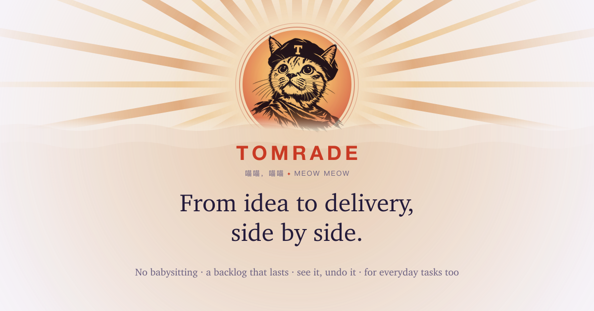
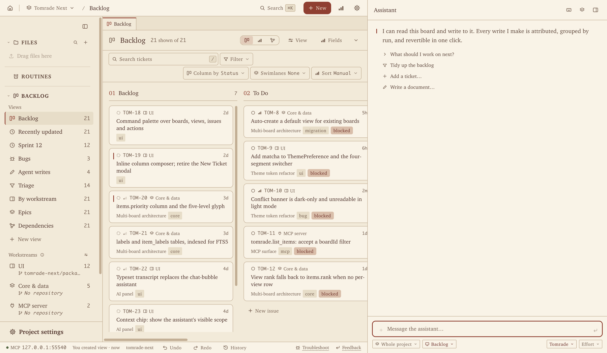
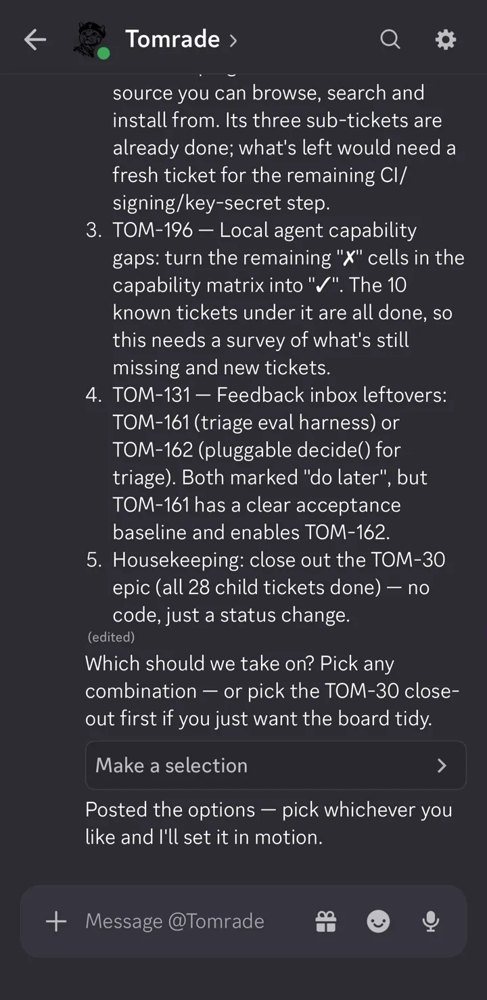
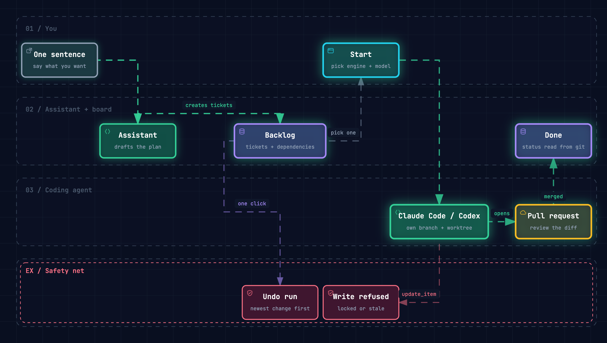
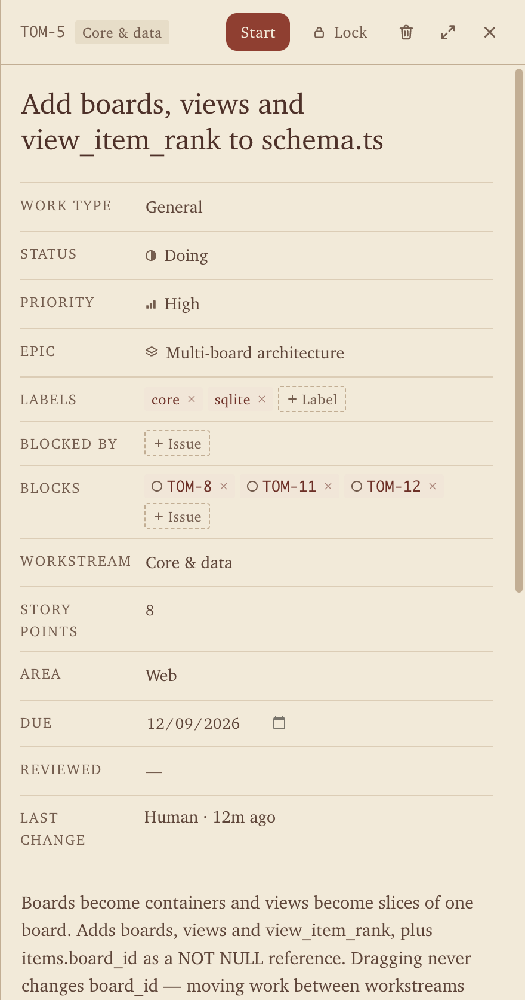
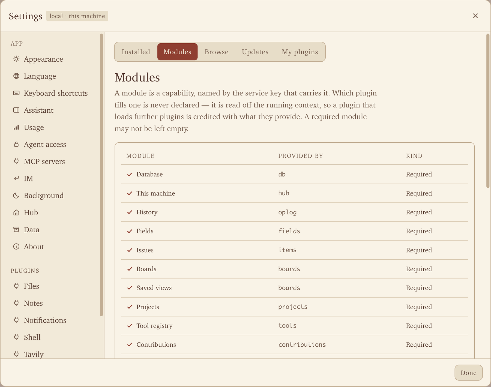
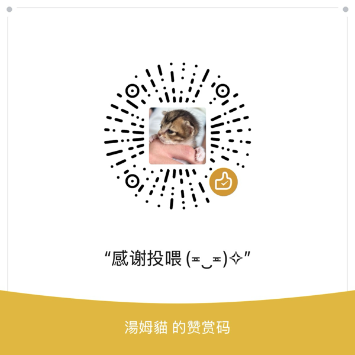

<p align="center">
  
</p>

<p align="center">
  <a href="https://tomrade.com">Website</a> ·
  <a href="https://tomrade.com/download">Download</a> ·
  <a href="#connect-your-agents">Connect your agents</a> ·
  <a href="#build-from-source">Build from source</a> ·
  <a href="https://github.com/haoyuant/tomrade-plugins">Plugins</a> ·
  <a href="README.zh-CN.md">简体中文</a>
</p>

<p align="center">
  <a href="LICENSE"></a>
  
  
</p>

# Tomrade

**Tom + comrade.** Tasks, notes and agents, in one folder you own.

Your agents work at **3 a.m.** They read your tickets, edit your notes, and now and then rewrite **everything you own.** Tomrade is the workspace built for them, with **an undo button built for you.**

It's a local-first workspace for solo makers and tiny teams. Run a codebase, your week, a journal or a shelf of docs from the same app. Say one sentence and the assistant drafts the whole backlog; hand a ticket to Claude Code, Codex or whichever coding agent you use; undo any agent run in one click.

<p align="center">
  
</p>

> [!NOTE]
> **Preview.** Until 1.0, Tomrade is in development and testing: things change from week to week and you will hit rough edges. Your projects are plain folders on your own disk, so back up the ones that matter.

## Not just for code

Every project is a board plus a folder of files. Connect it to a repository, or fill it with nothing but your week.

- **Ship software.** Talk a feature into tickets sized for one pull request, then let Claude Code or Codex build each one on its own branch.
- **Run your week.** Errands, chores and plans on a board or a table. Brain-dump to the assistant and it sorts the mess into tasks.
- **Keep a journal.** Today's note opens a dated page in your Journal folder. Tag the days and link them with `[[wiki links]]`.
- **Write docs.** Markdown with a live preview, backlinks and full-text search. Every save is versioned and can sync to a GitHub repo.

## What's in the box

**🗣️ From a sentence to a pull request.** Talk, plan, apply, build. Describe what you want in plain words and the assistant asks what it needs to know. It drafts epics and features sized for one PR, checks them against what already exists, and points out what's missing. The whole tree lands in one run. Press **Start** on a ticket and your own Claude Code, Codex, Gemini CLI or OpenCode picks it up on its own branch, reading and updating the ticket as it works. *Approval queue: none. Vibes: immaculate.*

**🌙 Auto run. Go to bed.** The agent reads the project and the backlog and lays out a plan on the dependency graph: what to run, what to leave for a person, which dependencies are missing. You pick the nodes, give any of them its own agent and merge setting or let work rules choose (docs tickets on a cheaper model, say), say whether they run in terminal panes you can watch or in background sessions, and set the limits: how many at once, how much to spend, how many failures in a row before it stops. Let it run until everything is done or stuck, or choose a night shift with a time limit. Tomrade works through the tickets in dependency order. A failure stays with its ticket and whatever depends on it, when an agent runs out of quota the next available agent takes the ticket on its branch (or it waits, if you said so), and nothing merges unless you said so and its checks pass. You hear about every step. When an agent finds a problem outside its ticket it files one, a second model decides whether it joins the run, and what joins is marked on the plan, up to a limit. Afterwards a report says which pull request to review first, how each delivery measures up against its ticket, and what is waiting for you.

**⏪ No approval queue. Just undo.** *Approval queues? In this economy?* Agents write straight to the backlog, so nothing waits on you. Every run is grouped and attributed, and when one gets creative (renames "Fix login" to "Rewrite auth from scratch", marks all 14 tickets Urgent), a single click puts all of it back. It never happened. History shows who changed what, run by run.

**🖥️ The terminal, right next to the board.** *Alt-Tab cardio: cancelled.* Run Claude Code, Codex or a plain shell in Tomrade's own Terminal window, one click from the backlog.

- **Split it your way:** `⌘D` to the right, `⇧⌘D` down. Save a layout you like and open every new window with it.
- **Sessions connect on their own.** Start a ticket and it opens in a pane; when an agent in a plain terminal claims a ticket, that pane becomes its session.
- **See who needs you.** Each pane's bar says Running, Needs you or Idle, and Continue nudges a session on without leaving the window.
- **Nothing gets lost.** Quit Tomrade and your agents keep working; restart herdr and the layout comes back, every agent resuming its conversation.

The window is built on [herdr](https://herdr.dev), the open-source agent multiplexer. On Windows herdr can't attach directly yet, so a ticket you start runs in the assistant panel, in herdr's own client or in Windows Terminal, and its status still comes back to the board.

**📓 A notebook that lives next to your board.** Each project carries a folder of files: Markdown, HTML, images, anything. `[[Wiki links]]` and backlinks that follow a rename, `#tags`, full-text search across every file, and today's journal page in one click. Read, Edit or Split, with the preview scrolling in step. Every save is versioned and can sync to a GitHub repo. Attach files to tickets as deliverables, and let agents search your notes.

**💬 Ask it about anything in Tomrade.** It isn't only a backlog planner. *"Put the checkout tickets in To Do"* moves four tickets. *"Turn this week's journal into a weekly review"* reads five entries and saves one, linked back to each day. *"Switch to dark mode, and put the cat on my desktop."* Done. And when there's nothing to do, it's happy to just talk: Biscuit or Mochi for the corgi? *No tools. No changes. Just vibes.* Every change it makes is attributed and lands in History, where ⌘Z takes it back: tickets, files and settings alike.



**📱 Away from your desk? Message it.** *Toilet-break productivity unlocked.* Connect a bot in Discord, Slack, Telegram, Feishu / Lark, DingTalk or WeCom, and the assistant answers in direct messages and @mentions: the same project, the same tools, from your phone.

- Message it like anyone else. 👀 means it's on it.
- The tools it calls tick off as it works.
- When it needs your call, you get buttons and menus.
- `/new`, `/stop` and `/status` run its sessions.

Tomrade on your computer talks to each chat app directly, with no server of ours in between. Bot credentials stay encrypted on that computer. Using something else? An IM is a plugin: write an adapter, or have an agent build one in Plugin Studio.

<br clear="right">

**📥 The backlog has a bouncer now.** Feedback waits at the door, not in your backlog. GitHub issues (and any source a plugin adds, like your support mail or a feedback form) land in the project's inbox first. The assistant proposes what each one is (a new ticket, a bug you already have, or a duplicate) and drafts the reply. You click Confirm. A repeat is counted on its ticket, so you can see what people keep running into, and whoever wrote hears back where they wrote.

**🤝 Comrade, not foreman.** Work where you like; Tomrade keeps track. Other tools want the work done inside them, or only ever hand it out. Tomrade goes both ways: press Start to hand a ticket out, or keep working in the Claude Code or Codex you've already tuned, in your own terminal, and run `/tomrade:sync` (`$tomrade-sync` in Codex) to bring the session back. Git keeps score: name `TOM-42` in a branch or a commit and the ticket follows it to Doing, Verifying and Done. Never required: work with no ticket stays yours, and nothing asks you to file one first.

**✏️ Draw it in one sentence.** [Archify](https://github.com/tt-a1i/archify) comes built in. Ask the assistant, Claude Code or Codex for an architecture, workflow, sequence, data-flow or lifecycle diagram, and it lands in the conversation as a live page you can pan, zoom, trace and present. Every render is checked for overlapping boxes, crossed wires and clipped labels, and the diagram keeps its JSON source, so a follow-up edits it instead of starting over.

<p align="center">
  <a href="https://tomrade.com/diagrams/workflow/"></a><br>
  <sub>"Draw how a ticket gets from one sentence to a merged PR." Rendered by the Archify that ships with Tomrade. <a href="https://tomrade.com/diagrams/workflow/">Open it live</a>.</sub>
</p>

**🧰 Also in the box.** Each one is a plugin; switch any of them off in Settings › Manage plugins.

- **Dependency graph:** see what blocks what, with a badge on every ticket still waiting on unfinished work.
- **Code link:** each ticket knows its branches, worktrees and pull requests. Its status follows git.
- **MCP client:** connect any MCP server over stdio or HTTP. Its tools join the built-in ones, for the assistant and every agent.
- **Files on GitHub:** share a project's files through a GitHub repository, found or created for you.
- **Scripted engine:** a menu of workflows that runs with no model at all. Offline, keyless, repeatable.
- **Plugin Studio:** describe the plugin you want. An agent writes and tests it, and it loads only after you confirm the build.

**🧩 Everything is a plugin, including yours.** The database, the tool registry, the MCP server and the assistant are each a plugin you can swap out. Write your own against the Apache-2.0 SDK and ship it under any license, or ask an agent to write one for you in Plugin Studio. Register a tool once and it appears in the assistant and on the MCP server. Official plugins live in [tomrade-plugins](https://github.com/haoyuant/tomrade-plugins).

**🍅 Lock in. Don't forget your Kegels.** *Your pelvic floor is calling.* A tomato lives in the status bar: 25 minutes of focus, 5 off, and a long break every fourth round. A desktop widget floats over every window and lets clicks through; your boss walks by and sees a clock. The alert can be any audio file. We recommend recording yourself saying "Kegels." Too comfy to click? Tell the assistant "start a pomodoro" and it presses the button. *Disclaimer: the timer reminds you to take a break. The clenching is on you.*

**🐱 Your agents have a supervisor now. It's a cat.** The pet lives on your desktop and mirrors what your agent is doing, so one glance tells you whether it needs you. No tab-switching, no notification spam. Several agents at once? It shows the one that needs you most.

<table>
  <tr>
    <td align="center"><br><sub><b>zzz</b><br>Off the clock</sub></td>
    <td align="center"><br><sub><b>???</b><br>Thinking…</sub></td>
    <td align="center"><br><sub><b>LOCKED IN</b><br>Galaxy-brain mode</sub></td>
    <td align="center"><br><sub><b>ANSWER ME!</b><br>Look in my eyes</sub></td>
    <td align="center"><br><sub><b>EZ</b><br>Insufferable</sub></td>
    <td align="center"><br><sub><b>EMOTIONAL DAMAGE</b><br>Something broke</sub></td>
  </tr>
</table>

Not a cat person? Bring your own pet: in Settings › Pet, give each mood its own GIF, WebP, PNG or JPEG. Moods you skip keep Nini, the built-in cat.

<table>
  <tr>
    <td width="36%"></td>
    <td></td>
  </tr>
  <tr>
    <td><sub>Every ticket says who changed it last, a person or an agent. Start hands it to your coding agent.</sub></td>
    <td><sub>Every module is a plugin. Switch them on and off in Settings › Manage plugins.</sub></td>
  </tr>
</table>

## Principles

Built so agents can move fast without stepping on you.

- **Your folder is the truth.** Each project is a folder of plain text you can read, diff and back up. SQLite is only a cache. *Delete the cache. It comes back. We'll wait.*
- **Human work comes first.** Every AI write is attributed and versioned. Fields you lock stay locked, and a write based on a stale read is refused, whoever sends it. The one write undo can't reach, a permanent delete, is human-only.
- **One set of tools, every surface.** The in-app assistant and the agents in your editor call the same tools. Add one once and it shows up everywhere.
- **Bring your own model.** DeepSeek, Anthropic, OpenAI, Gemini, Kimi, OpenRouter, any OpenAI-compatible endpoint or a local model, with more providers as [plugins](https://github.com/haoyuant/tomrade-plugins). Or let your own Claude Code or Codex conduct, on your own login.
- **It asks before it acts.** A shell command waits for your Allow once, Allow for this turn or Deny. A coding agent runs with the permissions you pick when you press Start. API keys, MCP servers and command lines are never an agent's to change.
- **Boards, tables and graphs.** Workstreams, custom fields and saved views. Keyboard-first, with a palette for everything.
- **Local first, account optional.** Choose "Use without an account" to keep preferences and the project list on this machine. Usage statistics have their own switch in Settings. An account only syncs your preferences and project list, never project content. Project content leaves your machine only if you connect a model provider or a git remote.

## How we use data

Usage statistics help us understand feature use and active time. They contain
predefined feature actions, a random rotating identifier, app/platform and
format versions, and a broad region—not project or ticket content, notes,
chats, code, file names, paths, email or account IDs. Analytics is separate
from account sign-in and project sync.

You can turn it off at any time in **Settings → Data & privacy → Anonymous
usage statistics**. This stops collection and uploads, clears unsent events
and deletes the local identity secret. Read [Data use and privacy](docs/data-privacy.md)
for the fields, retention, reset behavior and regional deployment conditions.

## Install

Free to use, on macOS, Windows and Linux. Get the installer for your system from **[tomrade.com/download](https://tomrade.com/download)** or the [GitHub releases](https://github.com/haoyuant/tomrade/releases).

| System | Installer | Notes |
|---|---|---|
| macOS 12+ (Apple silicon or Intel) | `.dmg` | Signed and notarized. Drag it to Applications and go. |
| Windows 10 / 11, 64-bit | `.exe` | Not code-signed yet, so SmartScreen will clutch its pearls: **More info → Run anyway**. Smart App Control blocks unsigned apps outright; read the [download page](https://tomrade.com/download) first. |
| Linux, x86-64 or arm64 | `.AppImage` | `chmod +x` and run. No `libfuse2` needed; where FUSE is missing altogether, run it with `--appimage-extract-and-run`. |

An installed copy checks for updates and installs one only when you say so. The interface speaks English, 简体中文, 繁體中文, 日本語, Español, Deutsch, Français and Русский.

Then:

1. Sign in, or choose "Use without an account".
2. Create a project and tell the assistant, in one sentence, what you're up to.
3. Optionally, connect your agents.

## Connect your agents

Tomrade runs an MCP server at `http://127.0.0.1:19090/mcp`. It listens on 127.0.0.1 only; nothing is exposed to the network.

**The easy way:** connect a repository once. In a project, open the repository a workstream stands for and connect coding agents, either **on this machine only** or **for the team** as a pull request with the MCP config and agent notes, so every agent that works in it finds Tomrade. Tomrade writes the config for Claude Code, Codex, Cursor, Gemini CLI, OpenCode, WorkBuddy and Pi, plus the notes that tell them how to claim a ticket and sync back. The details are in [`docs/agent-connections.md`](docs/agent-connections.md).

**By hand**, for any agent that speaks Streamable HTTP MCP:

```sh
# Claude Code
claude mcp add --transport http tomrade http://127.0.0.1:19090/mcp
```

```toml
# Codex: ~/.codex/config.toml
[mcp_servers.tomrade]
url = "http://127.0.0.1:19090/mcp"
```

```json
{
  "mcpServers": {
    "tomrade": { "type": "http", "url": "http://127.0.0.1:19090/mcp" }
  }
}
```

Your agent gets the same tools the assistant has: `list_items`, `get_item`, `create_item`, `update_item`, `change_status`, `claim_ticket`, `link_code`, `find_similar`, `plan_and_apply`, `search_files`, … plus whatever plugins add. Its writes follow the same rules as everyone's: attributed, versioned, refused on a locked field, undoable. The `whoami` tool tells it which Tomrade it reached.

## Build from source

You need Node.js (CI uses 26) and pnpm 11 (`corepack enable` picks the pinned version).

```sh
git clone https://github.com/haoyuant/tomrade.git
cd tomrade
pnpm install
pnpm dev          # builds the backend, then Vite + Electron
```

A checkout run with `pnpm dev` keeps its own data and serves MCP on port **19091**, so it runs side by side with an installed Tomrade (`TOMRADE_MCP_PORT` picks another port).

```sh
pnpm typecheck     # tsc -b for the backend, then the UI
pnpm test          # vitest across every package
pnpm test:related  # only the tests that reach what you changed against origin/main
pnpm test:ui       # the Electron UI harness (slow)
pnpm --filter @tomrade/desktop package   # installers: DMG/ZIP, NSIS, AppImage
```

On macOS, run the tests on Homebrew's node rather than nvm's: a notarized node can make every child process wait 30 seconds or more. [`docs/testing.md`](docs/testing.md) explains that, and what the failure kinds at the end of `pnpm test` mean.

### Where to look

| Path | What |
|---|---|
| `apps/desktop` | Electron shell; `tomrade.yml` is the application, one row per plugin |
| `packages/ui` | React 19 renderer (TanStack Router/Query, Tailwind); strings in `src/lib/i18n-messages/` |
| [`packages/*`](packages/README.md) | the core and its plugins: items, storage, agent engines, MCP, files, notes, … The linked table gives each one's role and `ctx` key |
| [`docs/architecture.md`](docs/architecture.md) | product decisions, what we deliberately don't do, the package map, data model and write path |
| [`docs/plugin-api.md`](docs/plugin-api.md) | the plugin contract |
| [`CONTEXT.md`](CONTEXT.md) | the domain language: ticket, delivery, code link, sync back, … |

## Contributing

Issues and pull requests are welcome. [`CONTRIBUTING.md`](CONTRIBUTING.md) has the setup and the details; report a vulnerability privately as [`SECURITY.md`](SECURITY.md) says. A few house rules:

- **Plugins first.** If a feature can be a plugin, make it one; the core reads contracts only.
- **Every user-facing string goes through `t(...)`**, with both an English and a Chinese entry.
- **Short why-comments only.** The code says what; a comment says why.
- Run `pnpm typecheck` and `pnpm test:related` before opening a pull request.

Tomrade is built with Tomrade. The maintainer's backlog lives in a Tomrade project, and the agent config checked into this repository (`.mcp.json`, `.codex/`, `.cursor/`, `.gemini/`, `CLAUDE.md`, `AGENTS.md`) points at it. Without that project on your machine the `tomrade` server simply isn't there, and your agent carries on as usual. Ticket keys in commit messages (`TOM-42: …`) are the maintainer's habit; you don't need one.

Built with help: [the people who shaped Tomrade](https://tomrade.com/thanks/) with their ideas, their testing and their patience with early builds.

## Buy me a coffee

I build Tomrade on my own, after work. It's free.

It started when I was learning agent development and using Claude Code on my own stuff. The more agents I ran, the more I turned into a dispatcher, digging through terminals to find whichever one got stuck this time. So I built a tool for it, handed it to some dev friends, and let them roast it until it got good.

Honestly, the agents do most of the work now. I review PRs and drink coffee. Problem is, agents don't drink coffee. They eat tokens, buffet-style. Your coffee turns into tokens, tokens turn into PRs, PRs turn into next week's release. Conservation of energy.

The cat supervises for free. The agents don't.

- ☕ [Buy Me a Coffee](https://buymeacoffee.com/tomrade)
- Alipay / WeChat Pay: scan below

<p>
  
  
</p>

Fun fact: you can undo pretty much anything in Tomrade. Not this, though 😂

Can't chip in? No worries. Open an issue or tell a friend, that makes my day too.

## FAQ

**Is it only for programmers?** No. The board, the assistant and Files work for any project: a household, a trip, a thesis, a journal. Coding agents join in when a project has a repository and stay out of the way when it doesn't.

**Where is my data?** In one plain folder per project, on your machine.

**Do I need an account?** No. Choose "Use without an account" to keep preferences and the project list on this machine. Usage statistics have their own switch in Settings. Signing in only keeps your preferences and project list in sync across computers; tickets, files and code stay in your project folders.

**Can I turn the cat off?** Yes, in Settings. You can also swap it for a pet of your own, or unload the pet plugin entirely. The cat will not take it personally. Probably.

**Is there a phone app?** It's on the way. Can't wait? Message the assistant from Discord, Slack, Telegram, Feishu, DingTalk or WeCom today. It answers as long as Tomrade runs on your computer, which it can keep doing in the background with every window closed. Pulling an all-nighter is the computer's job, not yours.

**Will the pomodoro remind me to do my Kegels?** Officially, it only reminds you to take a break. Unofficially, the alert can be any audio file you like. You know what to do.

## License

Free to use. [Apache License 2.0](LICENSE): the app, every package and the plugin SDK alike.

- Use it, change it and redistribute it, at home or at work, commercially too.
- Plugins are yours. Ship them under any license, commercial ones included.
- The one thing it doesn't grant: the Tomrade name and logo.

<p align="center"><sub>Ship more. Approve less. Be this cat. 🐱</sub></p>
