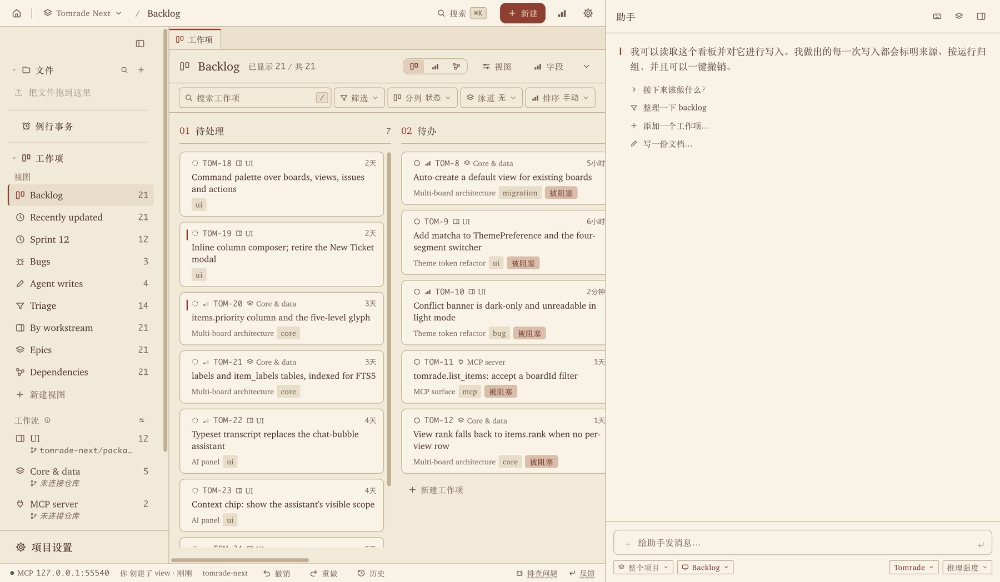
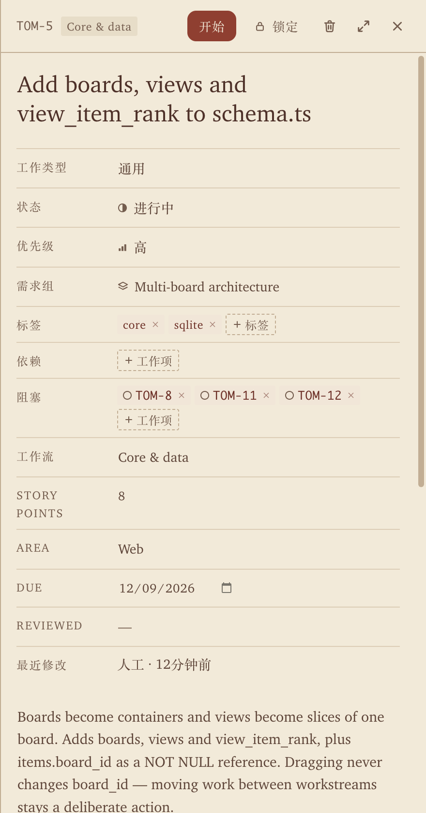
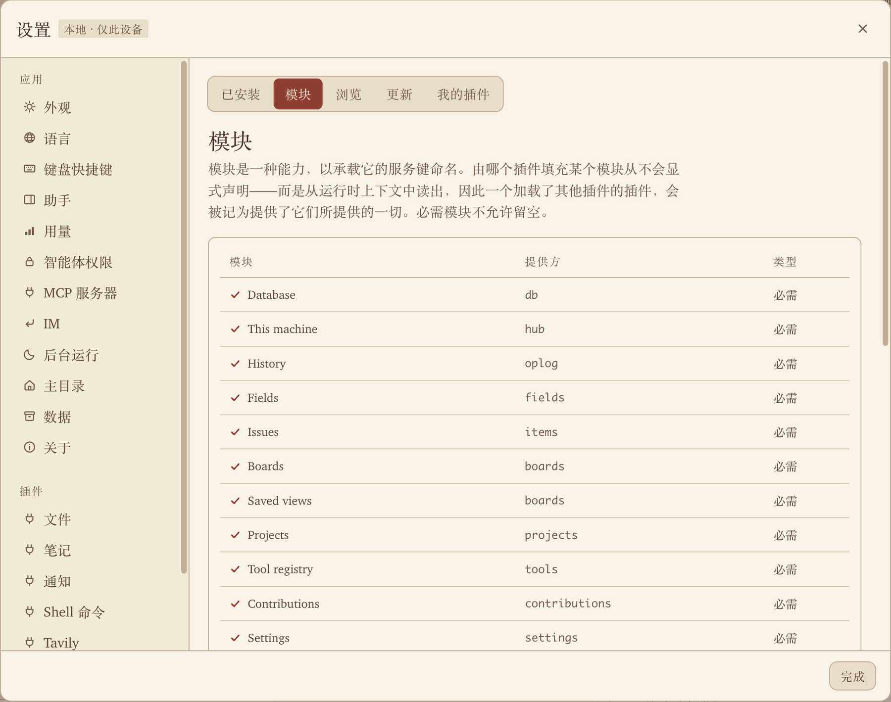

<p align="center">
  
</p>

<p align="center">
  <a href="https://tomrade.com/zh/">官网</a> ·
  <a href="https://tomrade.com/zh/download">下载</a> ·
  <a href="#接入你的-agent">接入 Agent</a> ·
  <a href="#从源码构建">从源码构建</a> ·
  <a href="https://github.com/haoyuant/tomrade-plugins">插件</a> ·
  <a href="README.md">English</a>
</p>

<p align="center">
  <a href="LICENSE"></a>
  
  
</p>

# Tomrade

**Tom + comrade，你和 Agent 的好战友。** 任务、笔记和 Agent，都在你自己的文件夹里。

你的 Agent **凌晨三点**还在干活。它读工单、改笔记，偶尔把**你所有的东西**都重写一遍。Tomrade 是为它们造的工作区，顺便**给你配了一个撤销键**。

这是一个为独立创作者和小团队打造的本地优先桌面应用。代码项目、这周的待办、日记、一摞文档，都能在同一个地方管。说一句话，助手就把整个需求池拆好；工单交给 Claude Code、Codex 或你在用的其他编程 Agent 去做；Agent 的任何一次运行都能一键撤销。

<p align="center">
  
</p>

> [!NOTE]
> **测试版。** 1.0 之前 Tomrade 还在开发测试中，功能每周都在变，难免有不完善的地方。你的项目就是自己硬盘上的普通文件夹，重要的请自行备份。

## 盒子里有什么

**🗣️ 从一句话到一个 PR。** 用大白话说出你想要什么。助手会追问必要的细节，拆成史诗和一个 PR 就能完成的功能，对照已有内容去重，并指出还缺什么。整棵需求树一次写入。在工单上点「开始」，你自己的 Claude Code、Codex、Gemini CLI 或 OpenCode 就会在独立分支上接手。

**⏪ 不设审批，只留撤销。** *审批队列？都什么年代了。* Agent 直接写进需求池，不用等你点头。每次运行都打包记账、注明出处；哪次它放飞自我了（把「修复登录」改名成「从零重写认证」，顺手把 14 张工单全标成紧急），一键整体撤回，就当无事发生。

**🤝 是战友，不是包工头。** 别的工具要么让你只能在它里面干活，要么只会把活派出去。Tomrade 两头都通：点「开始」把工单派出去；或者接着在你调教好的 Claude Code、Codex 里、在你自己的终端里干，完事敲一句 `/tomrade:sync`（Codex 里是 `$tomrade-sync`）把这次会话同步回来。git 负责记分：分支名里带上 `TOM-42`，工单就跟着它走到进行中、验证中、已完成。没有工单的活也照干不误，没人逼你先建工单。

**🖥️ 终端，就开在看板旁边。** *告别在十个终端窗口间反复横跳。* 基于 [herdr](https://herdr.dev) 的终端窗口，分屏跑你的 Agent，每个窗格连着它的工单，标题栏写着「运行中」「需要你」还是「空闲」。退出 Tomrade，Agent 照样接着干。

**📓 看板旁边，就是你的笔记本。** 每个项目都自带一个文件夹：Markdown 实时预览、`[[双链]]` 和反向链接、`#标签`、全文搜索、一键打开今天的日记。每次保存都有版本，还能同步到 GitHub 仓库。文件可以挂到工单上当交付物。

**💬 Tomrade 里的事，都能问它。** 助手不只会拆需求池。它能挪工单、把五篇日记汇总成周报、帮你切到深色模式、用内置的 [Archify](https://github.com/tt-a1i/archify) 画架构图，也能陪你纠结柯基该叫饼干还是麻薯。它做的每处改动都记在历史里，⌘Z 就能撤回。

**📱 人不在电脑前，发消息找它。** *带薪蹲坑，也能派活。* 在 Discord、Slack、Telegram、飞书 / Lark、钉钉或企业微信里接上一个机器人，拿着手机就能用：同一个项目，同一套工具。Tomrade 直接连各家聊天软件，中间没有我们的服务器。

**📥 需求池门口，有保安了。** GitHub issue（以及插件接入的其他来源）先在项目的收件箱里排队。助手判断每一条是什么：新工单、已有的老问题，还是重复反馈，并拟好回复。你点一下确认就行。

**🧩 一切皆插件，包括你写的。** 数据库、工具注册表、MCP 服务、助手，每一块都是可以替换的插件。用 Apache-2.0 授权的 SDK 写你自己的插件，用任何许可证发布；或者在 Plugin Studio 里说出你想要什么，让 Agent 来写、来测，你确认这次构建之后它才会加载。官方插件在 [tomrade-plugins](https://github.com/haoyuant/tomrade-plugins)。

**🐱 AI 在打工，猫猫在监工。** 桌宠会演出你的 Agent 正在干什么：摸鱼、思考、超频中、盯着你直到你回答它的问题；跑完了嚣张整整三秒，出错了替你哭三秒，你负责 ⌘Z。不是猫派？换成你自己的桌宠。

**🍅 专注搬砖，别忘了提肛。** 状态栏里住着一颗番茄：25 分钟专注，5 分钟休息。提示音可以换成任何音频文件。至于这 5 分钟拿来干什么，久坐打工人都懂。

<table>
  <tr>
    <td width="36%"></td>
    <td></td>
  </tr>
  <tr>
    <td><sub>每张工单都写着最后是谁改的，人还是 Agent。点「开始」就交给你的编程 Agent。</sub></td>
    <td><sub>每个模块都是插件，在「设置 › 管理插件」里随开随关。</sub></td>
  </tr>
</table>

## 设计原则

让 Agent 跑得快，又不踩到你。

- **文件夹就是真相。** 每个项目都是一个纯文本文件夹，可读、可 diff、可备份。SQLite 只是缓存。*缓存删了？没事，它自己会回来。*
- **人的工作优先。** 每次 AI 写入都记录是谁写的、基于哪个版本。你锁定的字段不会被覆盖，基于过期数据的写入一律拒绝，不管是谁发的。撤销唯一够不着的写入是永久删除，所以只有人能做。
- **一套工具，处处可用。** 应用内的助手和编辑器里的 Agent 调用的是同一套工具。注册一次，两边都能用。
- **模型自己选。** DeepSeek、Anthropic、OpenAI、Gemini、Kimi、OpenRouter、任何 OpenAI 兼容接口或本地模型都行，更多厂商以[插件](https://github.com/haoyuant/tomrade-plugins)形式提供。也可以让你自己的 Claude Code 或 Codex 来主导，用你自己的登录。
- **动手之前，先问你。** Shell 命令会等你选允许或拒绝。API Key、MCP 服务器和命令行设置，永远轮不到 Agent 来改。
- **本地优先，账号可选。** 选「不登录，本地使用」，一切都只在这台电脑上。登录账号只同步偏好设置和项目列表，从不碰项目内容。只有你接了模型服务或 git 远程仓库，项目内容才会离开你的电脑。

## 安装

在 **[tomrade.com/zh/download](https://tomrade.com/zh/download)** 或 [GitHub Releases](https://github.com/haoyuant/tomrade/releases) 下载对应系统的安装包。

| 系统 | 安装包 | 说明 |
|---|---|---|
| macOS 12+（Apple 芯片或 Intel） | `.dmg` | 已签名并经过 Apple 公证，拖进「应用程序」即可。 |
| Windows 10 / 11，64 位 | `.exe` | 暂时还没有代码签名，SmartScreen 会大惊小怪：点 **更多信息 → 仍要运行**。Windows 11 的智能应用控制会直接拦下未签名应用，安装前请先看[下载页](https://tomrade.com/zh/download)的说明。 |
| Linux，x86-64 | `.AppImage` | `chmod +x` 后运行。较新的 Ubuntu 需要先装 `libfuse2`（24.04 上是 `libfuse2t64`）。 |

装好的 Tomrade 会检查更新，你同意了才安装。界面支持 English、简体中文、繁體中文、日本語、Español、Deutsch、Français 和 Русский。

然后：建个项目，用一句话告诉助手你在忙什么；想的话，再接上你的 Agent。

## 接入你的 Agent

Tomrade 在本机运行一个 MCP 服务，地址是 `http://127.0.0.1:19090/mcp`。只监听 127.0.0.1，不对外网暴露。

**省事的办法：** 在项目里打开工作流对应的代码仓库，连接编程 Agent，可以选**仅本机**，也可以选**为团队**（开一个 PR）。Tomrade 会替 Claude Code、Codex、Cursor、Gemini CLI、OpenCode、WorkBuddy 和 Pi 写好配置，再附上一份说明，告诉它们怎么认领工单、怎么同步回来。细节见 [`docs/agent-connections.md`](docs/agent-connections.md)。

**手动配置**，适用于任何支持 Streamable HTTP MCP 的 Agent：

```sh
# Claude Code
claude mcp add --transport http tomrade http://127.0.0.1:19090/mcp
```

```toml
# Codex：~/.codex/config.toml
[mcp_servers.tomrade]
url = "http://127.0.0.1:19090/mcp"
```

```json
{
  "mcpServers": {
    "tomrade": { "type": "http", "url": "http://127.0.0.1:19090/mcp" }
  }
}
```

接上之后，你的 Agent 拿到的工具和助手一模一样：`list_items`、`get_item`、`create_item`、`update_item`、`change_status`、`claim_ticket`、`link_code`、`find_similar`、`plan_and_apply`、`search_files`……再加上插件提供的。它的写入和所有人守同一套规矩：注明出处、带版本、碰到锁定字段就拒绝、随时可撤销。`whoami` 工具会告诉它连上的是哪个 Tomrade。

## 从源码构建

需要 Node.js（CI 用的是 26）和 pnpm 11（`corepack enable` 会用仓库锁定的版本）。

```sh
git clone https://github.com/haoyuant/tomrade.git
cd tomrade
pnpm install
pnpm dev          # 先构建后端，再启动 Vite + Electron
```

用 `pnpm dev` 跑起来的开发版有自己独立的数据，MCP 端口是 **19091**，可以和安装版同时运行（用 `TOMRADE_MCP_PORT` 换端口）。

```sh
pnpm typecheck     # 先对后端 tsc -b，再检查 UI
pnpm test          # 所有包的 vitest
pnpm test:related  # 只跑和你相对 origin/main 的改动有关的测试
pnpm test:ui       # Electron UI 回归测试（慢）
pnpm --filter @tomrade/desktop package   # 打安装包：DMG/ZIP、NSIS、AppImage
```

在 macOS 上请用 Homebrew 的 node 跑测试，别用 nvm 的：经过公证的 node 可能让每个子进程都卡 30 秒以上。原因，以及 `pnpm test` 结尾那几类失败分别是什么意思，见 [`docs/testing.md`](docs/testing.md)。

### 代码在哪

| 路径 | 内容 |
|---|---|
| `apps/desktop` | Electron 外壳；`tomrade.yml` 就是整个应用，一行一个插件 |
| `packages/ui` | React 19 渲染进程（TanStack Router/Query、Tailwind）；文案在 `src/lib/i18n-messages/` |
| `packages/*` | 内核和各个插件：工单、存储、Agent 引擎、MCP、文件、笔记…… |
| [`docs/architecture.md`](docs/architecture.md) | 产品决策、刻意不做的事、完整的包地图、数据模型和写入路径（英文） |
| [`docs/plugin-api.md`](docs/plugin-api.md) | 插件契约（英文） |
| [`CONTEXT.md`](CONTEXT.md) | 领域术语：工单、交付、代码关联、同步回来……（英文） |

## 参与贡献

欢迎提 issue 和 PR。几条规矩：

- **能做成插件就做成插件。** 内核只读契约。
- **所有面向用户的文案都走 `t(...)`**，中英文都要写。
- **注释只写简短的「为什么」。** 代码说明做了什么，注释说明为什么这么做。
- 开 PR 之前跑一遍 `pnpm typecheck` 和 `pnpm test:related`。

Tomrade 是用 Tomrade 开发的。维护者的需求池放在一个 Tomrade 项目里，仓库里提交的 Agent 配置（`.mcp.json`、`.codex/`、`.cursor/`、`.gemini/`、`CLAUDE.md`、`AGENTS.md`）指向的就是它。你的电脑上没有那个项目的话，`tomrade` 服务就是不存在，你的 Agent 照常干活。提交信息里的工单号（`TOM-42: …`）是维护者的习惯，你不需要。

## 常见问题

**只给程序员用吗？** 不是。看板、助手和文件，管家务、旅行、论文、日记都行。项目连了代码仓库，编程 Agent 才会加入；没连，它们就不掺和。

**数据存在哪？** 每个项目一个普通文件夹，就在你的电脑上。

**能把猫关掉吗？** 能，在设置里关，或者干脆卸载桌宠插件。猫不会往心里去的。大概吧。

**有手机 App 吗？** 还没有。在那之前，从聊天软件给助手发消息就行。只要电脑上的 Tomrade 开着它就会回，所有窗口都关了也能在后台接着跑。熬夜是电脑的事，不是你的。

## 许可证

[Apache License 2.0](LICENSE)：应用、所有包和插件 SDK 都一样。

- 随便用、随便改、随便再分发，在家在公司都行，商用也行。
- 插件归你。用什么许可证发布都可以，包括商业许可证。
- 唯一不授权的：Tomrade 的名字和 logo。

<p align="center"><sub>多交付，少审批。做一只嚣张的猫。🐱</sub></p>
