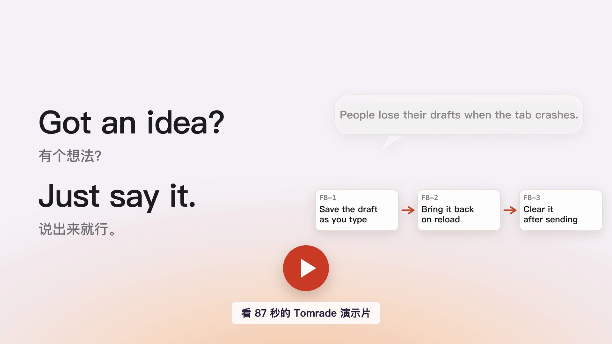
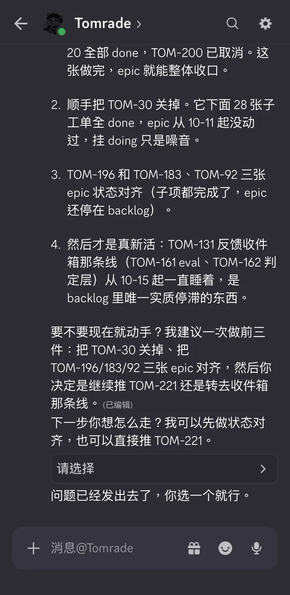
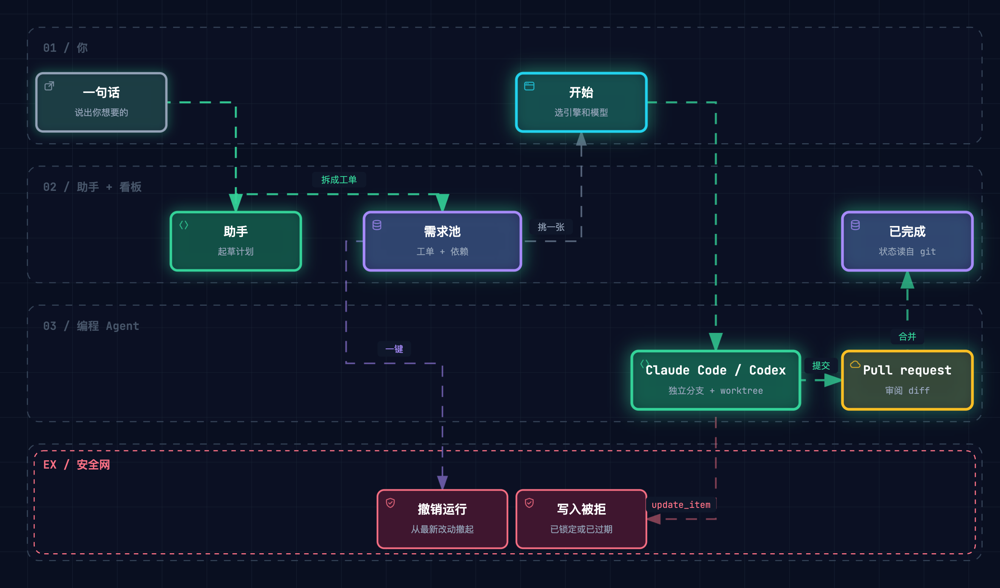
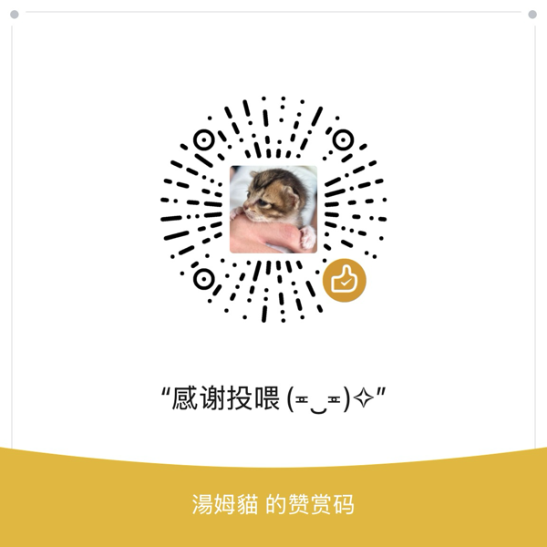

<p align="center">
  
</p>

<p align="center">
  <a href="https://tomrade.com/zh/">官网</a> ·
  <a href="https://tomrade.com/zh/download">下载</a> ·
  <a href="#接入你的-agent">接入 Agent</a> ·
  <a href="#从源码构建">从源码构建</a> ·
  <a href="https://github.com/haoyuant/tomrade-plugins">插件</a> ·
  <a href="#请我喝杯咖啡">☕ 请我喝杯咖啡</a> ·
  <a href="README.md">English</a>
</p>

<p align="center">
  <a href="LICENSE"></a>
  
  
</p>

# Tomrade

**Tom + comrade，你和 Agent 的好战友。** 任务、笔记和 Agent，都在你自己的文件夹里。

你的 Agent **凌晨三点**还在干活。它读工单、改笔记，偶尔把**你所有的东西**都重写一遍。Tomrade 是为它们造的工作区，顺便**给你配了一个撤销键**。

这是一个为独立创作者和小团队打造的本地优先工作区。代码项目、这周的待办、日记、一摞文档，都能在同一个应用里管。说一句话，助手就把整个需求池拆好；工单交给 Claude Code、Codex 或你在用的其他编程 Agent 去做；Agent 的任何一次运行都能一键撤销。

<p align="center">
  <a href="https://tomrade.com/zh/#films"></a><br>
  <sub>Tomrade 的一天，全部是应用里的真实画面。每个功能的短片都在 <a href="https://tomrade.com/zh/#films">tomrade.com</a>。</sub>
</p>

<p align="center">
  
</p>

> [!NOTE]
> **测试版。** 1.0 之前 Tomrade 还在开发测试中，功能每周都在变，难免有不完善的地方。你的项目就是自己硬盘上的普通文件夹，重要的请自行备份。

## 不只是写代码

每个项目都是一块看板加一个文件夹。可以连上代码仓库，也可以只装下你这一周的生活。

- **做软件。** 把一个功能聊成一个个 PR 大小的工单，再交给 Claude Code 或 Codex，各自在独立分支上实现。
- **管日常。** 跑腿、家务、出行计划，放进看板或表格。把脑子里的一团乱麻倒给助手，它帮你理成待办。
- **写日记。** 「今日笔记」会在日记文件夹里打开当天的一页。给日子打上标签，用 `[[双链]]` 把它们串起来。
- **写文档。** Markdown 实时预览、反向链接、全文搜索。每次保存都有版本，还能同步到 GitHub 仓库。

## 盒子里有什么

**🗣️ 从一句话到一个 PR。** 聊、拆、落、做。用大白话说出你想要什么，助手会追问必要的细节，拆成史诗和一个 PR 就能完成的功能，对照已有内容去重，并指出还缺什么。整棵需求树一次写入。在工单上点「开始」，你自己的 Claude Code、Codex、Gemini CLI 或 OpenCode 就会在独立分支上接手，边写代码边更新工单。PR 的 CI 挂了，或者有人评审、留言，正在做这张工单的 Agent 都会收到。*审批队列：无。效率：拉满。*

**🌙 自动执行：你去睡，它接着做。** 打开后 Agent 先读项目和需求池，在依赖图上给出计划：建议跑哪些工单、哪些要留给人、还缺哪些依赖。你在图上选节点，每个节点可以单独选 Agent 和合并方式，也可以用工作规则自动选（比如文档类工单用便宜的模型），决定在看得见的终端格子还是后台会话里跑，再设好上限：同时几张、最多花多少钱、连续失败几次就停。可以一直跑到完成或卡住，也可以选“夜班”限定时长。Tomrade 按依赖顺序一张张做。失败只影响这张工单和依赖它的工单，额度用完时由下一个可用的 Agent 在原分支接着做（也可以选择等待恢复），只有你同意且检查通过才自动合并。每一步都会通知你。Agent 发现范围外的问题时会开工单，由另一个模型判断现在做还是留到以后，插入的节点在计划上有标注，数量有上限。结束后有一份报告，告诉你先审哪个 PR、每张交付和工单的对照情况，以及哪些事在等你。

**⏪ 不设审批，只留撤销。** *审批队列？都什么年代了。* Agent 直接写进需求池，不用等你点头。每次运行都打包记账、注明出处；哪次它放飞自我了（把「修一下登录」改成「彻底重写鉴权」，顺手把 14 张工单全标成紧急），一键整体撤回，就当无事发生。历史面板按运行列出谁改了什么。

**🖥️ 终端，就开在看板旁边。** *告别在十个终端窗口间反复横跳。* 在 Tomrade 自带的终端窗口里直接跑 Claude Code、Codex 或普通 shell，开发和看板不用再来回切。

- **想怎么分就怎么分：** `⌘D` 向右，`⇧⌘D` 向下。顺手的布局存下来，新窗口直接套用。
- **会话自己连上。** 开始一个工单，它就出现在一个窗格里；普通终端里的 Agent 一认领工单，这个窗格就成了那张工单的会话。
- **谁在等你，一眼看清。** 每个窗格的标题栏都标着运行中、需要你还是空闲，点「继续」就能推它一把，不用离开窗口。Agent 停下来问要不要信任这个文件夹时，直接在会话卡片上点「信任并继续」或「退出」。
- **什么都不会丢。** 退出 Tomrade，Agent 照样在干；重启 herdr，布局原样回来，每个 Agent 接着之前的对话。

终端窗口基于开源的 Agent 终端复用器 [herdr](https://herdr.dev)。herdr 的直接连接暂不支持 Windows，所以在 Windows 上开始的工单会在助手面板、herdr 自带的客户端或 Windows Terminal 里跑，状态照样同步回看板。

**📓 看板旁边，就是你的笔记本。** 每个项目都自带一个文件夹：Markdown、HTML、图片，什么都能放。`[[双链]]` 和反向链接（笔记改名，链接自动跟着改）、`#标签`、覆盖每个文件的全文搜索、一键打开今天的日记。阅读、编辑、分屏三种模式，预览随编辑同步滚动。每次保存都有版本，还能同步到 GitHub 仓库。文件能挂到工单上当交付物，Agent 也能搜索你的笔记。

**💬 Tomrade 里的事，都能问它。** 它不只会拆需求池。*「把结账相关的工单都挪到待办」*，4 张工单就挪好了；*「把这周的日记整理成一份周回顾」*，它读完 5 篇日记，存成一份周回顾，每一天都链回原文；*「换成深色主题，再把猫放到桌面上」*，好了。没活干的时候，陪你聊聊天也行：柯基叫「饼干」还是「麻薯」？*不调工具，不改东西，纯陪聊。* 它做的每处改动都会署名、记进历史，⌘Z 就能撤回：工单、文件、设置都一样。



**📱 人不在电脑前，发消息找它。** *带薪蹲坑，也能派活。* 在 Discord、Slack、Telegram、飞书 / Lark、钉钉或企业微信里接上一个机器人，私信它、在群里 @ 它都行。同一个项目、同一套工具，拿着手机就能用。

- 像跟人聊天一样发消息，它回个 👀 就是接活了。
- 它调了哪些工具，一个个打勾给你看。
- 需要你拍板时，直接给按钮和下拉选项。
- 用 `/new`、`/stop`、`/status` 开新会话、停下、查状态。

由你电脑上的 Tomrade 直连各个聊天软件，中间不经过我们的服务器。机器人凭据只加密保存在这台电脑上。用的不在列表里？IM 也是插件：写一个适配器，或者让 Agent 在 Plugin Studio 里替你写。

<br clear="right">

**📥 需求池门口，有保安了。** 反馈先在门口等着，不直接塞进需求池。GitHub issue（以及插件接入的其他来源，比如客服邮箱、反馈表单）先落进项目的收件箱。助手判断每一条是什么：新工单、已有的老问题，还是重复反馈，并拟好回复。你点一下确认就行。同一个问题再被报一次，会记在它的工单上，大家反复踩的坑一眼就看得出；反馈人在哪儿提的，就在哪儿收到回音。

**🤝 是战友，不是包工头。** 活儿在哪干都行，账都记在 Tomrade。别的工具要么让你只能在它里面干活，要么只会把活派出去。Tomrade 两头都通：点「开始」把工单派出去；或者接着在你调教好的 Claude Code、Codex 里、在你自己的终端里干，完事敲一句 `/tomrade:sync`（Codex 里是 `$tomrade-sync`）把这次会话同步回来。git 来记账：分支名或提交信息里写上 `TOM-42`，工单就跟着走到进行中、验证中、已完成。从不强制：没有工单的活照样干，没人逼你先建工单。

**✏️ 一句话，画出设计图。** [Archify](https://github.com/tt-a1i/archify) 已经内置。让助手、Claude Code 或 Codex 画一张架构图、流程图、时序图、数据流图或状态图，它会直接出现在对话里：能拖动、缩放、追踪路径，还能全屏演示。每次渲染都自动检查方框不重叠、连线不交叉、文字不截断；保留 JSON 源文件，下次提修改是在原图上改，不用推倒重画。

<p align="center">
  <a href="https://tomrade.com/zh/diagrams/workflow/"></a><br>
  <sub>「画一下：一张工单怎么从一句话走到合并的 PR。」由 Tomrade 自带的 Archify 渲染。<a href="https://tomrade.com/zh/diagrams/workflow/">打开可交互版</a>。</sub>
</p>

**🧰 盒子里还有。** 每一个都是插件，不需要的话，在「设置 › 管理插件」里关掉即可。

- **依赖图：** 谁卡着谁，一目了然；还在等未完成工作的工单都会挂上标记。
- **代码关联：** 每张工单都知道自己的分支、worktree 和 PR，状态跟着 git 走。
- **接管现有工作：** 扫描仓库里没合并的分支、闲置的 worktree 和未关闭的 GitHub issue（你同意的话，还有本机的 Claude Code 和 Codex 会话），生成一份需求池草稿。只有你勾选的才会变成工单。
- **公开构建页：** 把你勾选的路线图和更新日志，连同反馈入口，发布成你仓库 GitHub Pages 上的一个静态页。
- **Agent 成绩单：** 在「用量」里按写代码的引擎统计已合并的 PR：多少一次通过、每个花了多少，还能存成一张不含项目内容的分享图。
- **MCP 客户端：** 通过 stdio 或 HTTP 连接任意 MCP 服务，它的工具和内置工具放在一起，助手和每个 Agent 都能用。
- **文件同步到 GitHub：** 项目文件通过 GitHub 仓库共享，仓库可以帮你找到或新建。
- **脚本引擎：** 一份工作流菜单，完全不用模型：离线、免密钥、结果可复现。
- **Plugin Studio：** 说出你想要的插件，Agent 来写、来测；你确认这次构建之后，它才会加载。

**🧩 一切皆插件，包括你写的。** 数据库、工具注册表、MCP 服务、助手，每一块都是可以替换的插件。用 Apache-2.0 授权的 SDK 写你自己的插件，用任何许可证发布；也可以让 Agent 在 Plugin Studio 里替你写。注册一次工具，助手和 MCP 服务里就都有了。插件还能借用你自己的模型拿到 JSON 结果，全程碰不到密钥；也能把自己的反馈来源接进收件箱。官方插件在 [tomrade-plugins](https://github.com/haoyuant/tomrade-plugins)。

**🍅 专注搬砖，别忘了提肛。** *你的盆底肌来电了。* 状态栏里住着一颗番茄：25 分钟专注，5 分钟休息，每 4 轮来一次长休息。桌面浮窗悬浮在所有窗口上面，不挡点击；老板路过，只看见一个钟。提示音可以换成任何音频文件，建议亲自录一句「提肛」，效果拔群。懒得点？跟助手说一声「开个番茄钟」，它替你按。*免责声明：番茄钟只负责提醒你休息，提不提肛全凭自觉。*

**🐱 AI 在打工，猫猫在监工。** 桌宠待在你的桌面上，Agent 在干什么它就演什么。瞄一眼就知道要不要你出手，不用切窗口，也不用被通知轰炸。同时跑好几个 Agent？它只演最需要你的那个。

<table>
  <tr>
    <td align="center"><br><sub><b>zzz</b><br>摸鱼中</sub></td>
    <td align="center"><br><sub><b>？？？</b><br>思考中…</sub></td>
    <td align="center"><br><sub><b>超频中</b><br>火力全开</sub></td>
    <td align="center"><br><sub><b>Tell me why！</b><br>Look in my eyes!</sub></td>
    <td align="center"><br><sub><b>就这？</b><br>嚣张</sub></td>
    <td align="center"><br><sub><b>我哭死</b><br>破防了</sub></td>
  </tr>
</table>

不是猫派？换成你自己的桌宠：在「设置 › 宠物」里给每种心情配一张 GIF、WebP、PNG 或 JPEG。没配图的心情继续用内置的尼尼。

<table>
  <tr>
    <td width="36%"></td>
    <td></td>
  </tr>
  <tr>
    <td><sub>每张工单都写着最后是谁改的，人还是 Agent。点「开始」就交给你的编程 Agent。</sub></td>
    <td><sub>每个模块都是插件，在「设置 › 管理插件」里随开随关。</sub></td>
  </tr>
</table>

## 设计原则

让 Agent 跑得快，又不踩到你。

- **文件夹就是真相。** 每个项目都是一个纯文本文件夹，可读、可 diff、可备份。SQLite 只是缓存。*缓存删了？没事，它自己会回来。*
- **人的工作优先。** 每次 AI 写入都记录出处和版本。你锁定的字段不会被覆盖，基于过期数据的写入一律拒绝，不管是谁发的。撤销唯一够不着的写入是永久删除，所以只有人能做。
- **一套工具，处处可用。** 应用内的助手和编辑器里的 Agent 调用的是同一套工具。加一次工具，所有地方都能用。
- **模型自己选。** DeepSeek、Anthropic、OpenAI、Gemini、Kimi、OpenRouter、任何 OpenAI 兼容接口或本地模型都行，更多厂商以[插件](https://github.com/haoyuant/tomrade-plugins)形式提供。也可以让你自己的 Claude Code 或 Codex 来主导，用你自己的登录。
- **动手之前，先问你。** Shell 命令会等你选「允许一次」「本轮都允许」或「拒绝」。编程 Agent 按你点「开始」时选的权限运行。API Key、MCP 服务器和命令行设置，永远轮不到 Agent 来改。
- **看板、表格、依赖图。** 工作流、自定义字段和保存的视图。键盘优先，所有操作都能从命令面板找到。
- **本地优先，账号可选。** 选「不登录，本地使用」，偏好设置和项目列表留在本机；使用统计在设置中有独立开关。登录账号只同步偏好设置和项目列表，从不碰项目内容。只有你接了模型服务或 git 远程仓库，项目内容才会离开你的电脑。

## 我们如何使用数据

使用统计帮助我们了解功能使用情况和有效时长。它包含预先定义的功能动作、随机且
定期轮换的标识、应用/系统类别与格式版本，以及粗粒度地区；不含项目或工单内容、
笔记、聊天、代码、文件名、路径、邮箱或账号 ID。统计与账号登录、项目同步相互独立。

你可以随时在**设置 → 数据与隐私 → 匿名使用统计**中关闭：停止采集和上报、清空
待发事件并删除本地身份密钥。字段、保留期限、重置行为和地区部署条件详见
[数据使用与隐私说明](docs/data-privacy.zh-CN.md)。

## 安装

免费使用，支持 macOS、Windows 和 Linux。在 **[tomrade.com/zh/download](https://tomrade.com/zh/download)** 或 [GitHub Releases](https://github.com/haoyuant/tomrade/releases) 下载对应系统的安装包。

| 系统 | 安装包 | 说明 |
|---|---|---|
| macOS 12+（Apple 芯片或 Intel） | `.dmg` | 已签名并经过 Apple 公证，拖进「应用程序」即可。 |
| Windows 10 / 11，64 位 | `.exe` | 暂时还没有代码签名，SmartScreen 会大惊小怪：点 **更多信息 → 仍要运行**。Windows 11 的智能应用控制会直接拦下未签名应用，安装前请先看[下载页](https://tomrade.com/zh/download)的说明。 |
| Linux，x86-64 或 arm64 | `.AppImage` | `chmod +x` 后运行。不用装 `libfuse2`；系统完全没有 FUSE 时，加 `--appimage-extract-and-run` 运行。 |

装好的 Tomrade 会检查更新，你同意了才安装。界面支持 English、简体中文、繁體中文、日本語、Español、Deutsch、Français 和 Русский。

然后：

1. 登录，或者选「不登录，本地使用」。
2. 新建一个项目，用一句话告诉助手你在忙什么。
3. （可选）接入你的 Agent。

## 接入你的 Agent

Tomrade 在本机运行一个 MCP 服务，地址是 `http://127.0.0.1:19090/mcp`。只监听 127.0.0.1，不对外网暴露。

**省事的办法：** 仓库只需连接一次。在项目里打开工作流对应的代码仓库，连接编程 Agent，可以选**仅本机**，也可以选**为团队**：Tomrade 会提一个 PR，带上 MCP 配置和给 Agent 的说明，之后在这个仓库里干活的 Agent 都能找到 Tomrade。Claude Code、Codex、Cursor、Gemini CLI、OpenCode、WorkBuddy 和 Pi 的配置它都会写好，再附上一份说明，告诉它们怎么认领工单、怎么同步回来。细节见 [`docs/agent-connections.md`](docs/agent-connections.md)。

**手动配置**，适用于任何支持 Streamable HTTP MCP 的 Agent：

```sh
# Claude Code
claude mcp add --transport http tomrade http://127.0.0.1:19090/mcp
```

```toml
# Codex：~/.codex/config.toml
[mcp_servers.tomrade]
url = "http://127.0.0.1:19090/mcp"
```

```json
{
  "mcpServers": {
    "tomrade": { "type": "http", "url": "http://127.0.0.1:19090/mcp" }
  }
}
```

接上之后，你的 Agent 拿到的工具和助手一模一样：`list_items`、`get_item`、`create_item`、`update_item`、`change_status`、`claim_ticket`、`link_code`、`find_similar`、`plan_and_apply`、`search_files`……再加上插件提供的。它的写入和所有人守同一套规矩：注明出处、带版本、碰到锁定字段就拒绝、随时可撤销。`whoami` 工具会告诉它连上的是哪个 Tomrade。

## 请我喝杯咖啡

Tomrade 是我一个人下班后折腾出来的，免费用。

起因很简单：那阵子在学 Agent 开发，顺手拿 Claude Code 做自己的项目，结果 Agent 越开越多，我反倒成了调度员，天天在一堆终端里找哪个又卡住了。干脆自己做个工具，丢给身边写代码的朋友用，被他们吐槽了一轮又一轮，慢慢调教成了现在这样。

说实话，现在活基本都是 Agent 在干，我主要负责看 PR 和喝咖啡。问题是 Agent 不喝咖啡，它们吃 Token，还是自助餐那种吃法。你请的咖啡最后都会变成 Token，Token 变成 PR，PR 变成下周的新版本。能量守恒嘛。

猫猫监工不要钱，Agent 打工要。

- ☕ [Buy Me a Coffee](https://buymeacoffee.com/tomrade)
- 支付宝 / 微信扫下面的码

<p>
  
  
</p>

对了，Tomrade 里啥都能一键撤销，就这个不行 😂

白嫖也完全没问题，提个 issue、跟朋友安利一句，我一样开心。

## 从源码构建

需要 Node.js（CI 用的是 26）和 pnpm 11（`corepack enable` 会用仓库锁定的版本）。

```sh
git clone https://github.com/haoyuant/tomrade.git
cd tomrade
pnpm install
pnpm dev          # 先构建后端，再启动 Vite + Electron
```

用 `pnpm dev` 跑起来的开发版有自己独立的数据，MCP 端口是 **19091**，可以和安装版同时运行（用 `TOMRADE_MCP_PORT` 换端口）。

```sh
pnpm typecheck     # 先对后端 tsc -b，再检查 UI
pnpm test          # 所有包的 vitest
pnpm test:related  # 只跑和你相对 origin/main 的改动有关的测试
pnpm test:ui       # Electron UI 回归测试（慢）
pnpm --filter @tomrade/desktop package   # 打安装包：DMG/ZIP、NSIS、AppImage
```

在 macOS 上请用 Homebrew 的 node 跑测试，别用 nvm 的：经过公证的 node 可能让每个子进程都卡 30 秒以上。原因，以及 `pnpm test` 结尾那几类失败分别是什么意思，见 [`docs/testing.md`](docs/testing.md)。

### 代码在哪

| 路径 | 内容 |
|---|---|
| `apps/desktop` | Electron 外壳；`tomrade.yml` 就是整个应用，一行一个插件 |
| `packages/ui` | React 19 渲染进程（TanStack Router/Query、Tailwind）；文案在 `src/lib/i18n-messages/` |
| [`packages/*`](packages/README.md) | 内核和各个插件：工单、存储、Agent 引擎、MCP、文件、笔记……链接的表格列出每个包的作用和 `ctx` 键 |
| [`docs/architecture.md`](docs/architecture.md) | 产品决策、刻意不做的事、完整的包地图、数据模型和写入路径（英文） |
| [`docs/plugin-api.md`](docs/plugin-api.md) | 插件契约（英文） |
| [`CONTEXT.md`](CONTEXT.md) | 领域术语：工单、交付、代码关联、同步回来……（英文） |

## 参与贡献

欢迎提 issue 和 PR。环境搭建和细节见 [`CONTRIBUTING.md`](CONTRIBUTING.md)；安全漏洞请按 [`SECURITY.md`](SECURITY.md) 私下报告。几条规矩：

- **能做成插件就做成插件。** 内核只读契约。
- **所有面向用户的文案都走 `t(...)`**，中英文都要写。
- **注释只写简短的「为什么」。** 代码说明做了什么，注释说明为什么这么做。
- 开 PR 之前跑一遍 `pnpm typecheck` 和 `pnpm test:related`。

Tomrade 是用 Tomrade 开发的。维护者的需求池放在一个 Tomrade 项目里，仓库里提交的 Agent 配置（`.mcp.json`、`.codex/`、`.cursor/`、`.gemini/`、`CLAUDE.md`、`AGENTS.md`）指向的就是它。你的电脑上没有那个项目的话，`tomrade` 服务就是不存在，你的 Agent 照常干活。提交信息里的工单号（`TOM-42: …`）是维护者的习惯，你不需要。

感谢一路同行的人：[这些人](https://tomrade.com/zh/thanks/)用他们的想法、测试和对早期版本的耐心，塑造了今天的 Tomrade。

## 常见问题

**只给程序员用吗？** 不是。看板、助手和文件对任何项目都适用：家务、旅行、论文、日记都行。项目连了代码仓库，编程 Agent 就能上手；没连，它们也不会来打扰你。

**数据存在哪？** 每个项目一个普通文件夹，就在你的电脑上。

**需要注册账号吗？** 不需要。选「不登录，本地使用」，偏好设置和项目列表留在本机；使用统计在设置中有独立开关。登录只是为了在几台电脑之间同步偏好设置和项目列表；工单、文件和代码都留在你的项目文件夹里。

**能把猫关掉吗？** 能，在设置里关。也可以换成你自己做的桌宠，或者把桌宠插件整个卸载。猫不会往心里去的，大概。

**有手机 App 吗？** 在路上了。等不及的话，现在就能在 Discord、Slack、Telegram、飞书、钉钉或企业微信里给助手发消息。只要电脑上的 Tomrade 在跑，它就会回；关掉所有窗口，它也能在后台接着跑。通宵是电脑的事，不是你的事。

**番茄钟会提醒我提肛吗？** 官方口径：它只提醒你休息。非官方口径：提示音可以换成任意音频文件。懂的都懂。

## 许可证

免费使用，[Apache License 2.0](LICENSE) 开源：应用、所有包和插件 SDK 都一样。

- 随便用、随便改、随便再分发，在家在公司都行，商用也行。
- 插件归你。用什么许可证发布都可以，包括商业许可证。
- 唯一不授权的：Tomrade 的名字和 logo。

<p align="center"><sub>多交付，少审批。做一只嚣张的猫。🐱</sub></p>
