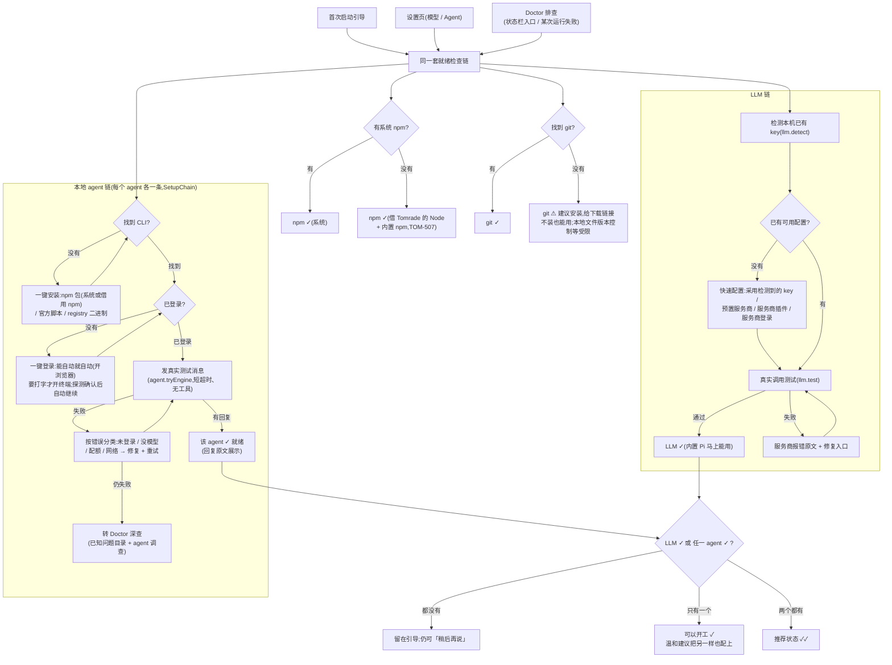
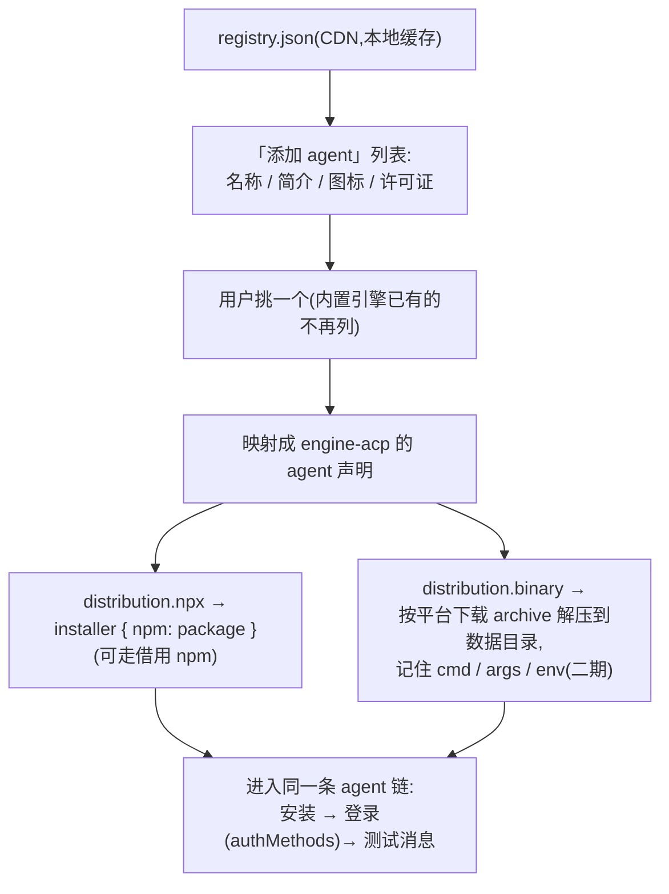

# 首次启动引导与问题排查的统一检查链(TOM-506 扩展设计)

> **Historical.** A design or implementation note from an earlier stage, kept for context; the code and the docs one level up are the current truth.

状态:提案(2026-10-21)。基于 TOM-506 epic 与其子票 TOM-507/508/509 的现状,
把"首次启动引导"和"排查问题(doctor)"合并成同一套就绪检查,并引入 ACP registry
做 agent 的自动发现与自动配置。

## 1. 背景与目标

今天有两套各自为政的"这台机器行不行"的判断:

- **首次启动引导**(`packages/ui/src/components/setup/FirstRunSetup.tsx` →
  `SetupOptions` → `QuickModelSetup` / `LocalAgentSetup` / `SetupChain`):
  交互式,带一键安装/登录/测试(TOM-508 的 `agentSetup` 服务 + TOM-509 的链式 UI),
  但 LLM 一侧配置完**没有实测调用**,也不看 npm/git。
- **Doctor**(`packages/doctor`):出问题后才进场,跑一组 `Check`
  (内置 `app` / `models` / `mcp` / `sync` / 按引擎 `probe`),其中 `models`
  已经会对每个 profile 发真实测试调用(`llm.test`),还有远端已知问题目录、
  agent 深查(investigate)和报告。但它的检查结果只给建议,不能直接拉起
  一键修复链。

目标:**检查(探测)与修复(动作)各一套,两边共用**。首次启动、设置页、doctor
三个入口跑同一组检查;每项检查失败时挂的修复动作,就是 TOM-508/509 做好的那条
一键链。通过标准统一为:**真实发消息拿到回复才算过**(TOM-503 的 `tried` 状态,
不再有第二套"就绪"标志)。

通过门槛(与现状 `setupState` 一致,保持不变):

- **LLM 和本地 agent 至少配好一个**即可开工:
  - LLM 配好 → 内置 Pi(`engine-pi`,`usesModels`,拿配置的 key 跑)和
    worker 角色都能用;
  - 本地 agent 配好 → 它把模型借给 worker(lent model),worker 也 ok。
- 两个都配好是**推荐状态**:只配了一个时,完成页温和提示把另一样也配上,
  但不阻塞。
- git 是**可选项**:没有也能用,只提示"涉及本地文件版本控制等功能需要它",
  绝不挡路。

## 2. 核心模型:一套检查,三个入口

### 检查项(probe,只读、可重复跑)

| 检查 | 怎么测 | 结果 |
| --- | --- | --- |
| `npm` | PATH 上找 npm;找不到则确认 Tomrade 自带 Node + 内置 npm 可用(TOM-507) | 永远能过,只区分"系统 npm"还是"借用的 npm" |
| `git` | 按 `packages/git` 现有的二进制解析方式找 git,`git --version` | ok / warn(建议安装 + 官方下载链接),从不 fail |
| `llm` | 有无可用 profile;有则 `llm.test` 真实调用 | ok / 未配置 / 调用失败(带服务商原话) |
| `agent:<id>`(每个建议的或已发现的 agent 一项) | `engine.available({fresh})` 探测 → 登录态 → `agent.tryEngine` 测试消息 | ready / 缺安装 / 缺登录 / 测试失败(按错误分类) |
| 门槛 | `llm ✓ ∨ 任一 agent ✓`(即现有 `setupState.complete`) | 可开工 / 还差一步 |

### 修复动作(fix,有状态、要确认或点击)

就是现在已经存在的那几条,不再新造:

- 安装/登录:`agentSetup.start`(TOM-508),npm 路径在没系统 npm 时自动走
  借用的 npm(TOM-507);
- 测试:`agent.tryEngine`(TOM-503/509);
- LLM:`llm.adopt`(采用检测到的 key)/ `llm.quickSetup` / 服务商插件 /
  `llm.signIn`,配完接 `llm.test` 实测;
- git:打开官方下载页(动作只是链接,不代装)。

### 三个入口,同一套东西

- **首次启动**:按顺序展示全部检查,未过的项直接内联一键链(今天的
  `SetupChain` 即该链的渲染),过门槛即可继续。
- **设置页**(模型 / Agent 两个 pane):同样的行,随时可重跑。
- **Doctor**:把这些检查并入它的 checklist(doctor 的 `Check` 契约本来就在
  `@tomradex/contracts` 里、本来就允许各包注册),每行失败时的 `actions`
  不再只是"去设置",而是能**直接拉起同一条 SetupChain**;反过来,首次启动里
  链条反复失败时,给"深入排查"入口,开一个带 `topic` 的 doctor 线程
  (已知问题目录 + agent 深查都在那边)。

这样"引导"和"排查"只是同一份检查结果的两种叙述:第一次见面叫引导,
出了问题叫排查。

## 3. 总流程图

注:npm / git 两项不在门槛里。npm 项因为有借用路径永远能过,存在的意义是
让 doctor 能说清"这台机器装 agent 用的是哪个 npm";git 项只影响提示文案。

## 4. 各检查项细节

### 本地 agent 链(现有 TOM-508/509,不变,只是复述其约定)

- 探测、安装、登录、测试四步;已满足的步骤直接打勾跳过
  (`chainSteps`,`packages/ui/src/lib/setupChain.ts`)。
- 登录能自动就自动:`signInRun`(SDK 0.2.26)由 Tomrade 自己跑并盯着,
  浏览器地址直接给按钮;只有要在终端打字的登录才开终端。
- 只有测试消息拿到非空回复才算 ready;结果按 (agent 版本 + 登录态) 记住,
  不在每次渲染重测(TOM-509 已定)。
- 失败分类沿用 `EngineSetupProgress.failure.kind` + `tried.error`,
  对应 `setup.fail*` 文案;分类之外的交给 doctor 的已知问题目录。

### LLM 链(新增的部分)

- 现状:`QuickModelSetup` 配完 key 即算 `worker.ok`,没有实测;实测逻辑在
  doctor 的 `models` check 里(`llm.test`,带错误分类)。
- 改法:配置动作(adopt / quickSetup / 插件 / signIn)成功后立刻 `llm.test`
  一次,结果像 agent 链一样显示为步骤列表的最后一步(通过显示耗时/模型,
  失败显示服务商原话 + 重试)。`setupState.complete` 的 `worker.ok`
  升级为"测过才算",与 agent 侧的 `tried` 对称。
- 检测到的本机 key(`llm.detect`)被采用后同样要过实测,避免"捡到一个
  过期 key 就算配好"。

### npm / node

- TOM-507 的借用方案(`ELECTRON_RUN_AS_NODE` + 内置 npm)让"没有 npm"
  不再是失败态。检查项只报告用的是哪条路径,并在 doctor 的 `app` 行附近
  作为 facts 露出(排查安装失败时第一个要知道的事实)。

### git

- 新检查:按 `gitRunner` 同样的方式找 git(GUI 启动的 Electron PATH 很短,
  不能只看 PATH),找不到给 warn:一句"不装也能用,但本地文件的版本控制、
  仓库相关功能需要它" + 官方下载链接。
- 不提供一键装 git(平台差异大、牵涉系统包管理器,收益低);只链接。
- 失败态只出现在"找到了但跑不动"(`git --version` 报错)这种罕见情况。

## 5. ACP registry 与 Zed 能帮什么

ACP registry 是 Zed 与 JetBrains 共同维护的 agent 目录(2026-01 上线,
2026-03 宣布格式稳定),正好补上"自动配置"缺的元数据:

- **取数**:客户端只拉一个文件
  `https://cdn.agentclientprotocol.com/registry/v1/latest/registry.json`,
  含全部 agent 的清单;图标在 `dist/<id>.svg`。本地缓存 + 最大时效,
  做法照抄 doctor 已有的已知问题目录(`fetchCatalog` / `CATALOG_MAX_AGE_MS`)。
- **安装元数据**:每个条目的 `distribution` 至少有 `binary`(按平台的
  `archive` 下载地址 + `cmd`/`args`/`env`)、`npx`(`package`/`args`/`env`)、
  `uvx` 之一。`npx` 条目直接映射成我们的
  `LocalAgentInstaller { npm: package }`——在没有 Node 的机器上走借用 npm
  (TOM-507),一键装就通了。
- **登录元数据**:registry 只收**支持认证**的 agent(CI 验证 `initialize`
  响应里 `authMethods` 非空)。两类:Agent Auth(agent 自己跑 OAuth,
  对应我们"能自动就自动"的无终端登录)和 Terminal Auth(终端交互登录,
  对应我们现有的开终端路径)。也就是说 registry 来的 agent 天然能进
  同一条链,登录方式不用人工调研。
- **测试**:ACP agent 的测试消息就是 `session/new` + 一个 prompt,
  `engine-acp` 已经会开一次性会话(`askCatalog` 同款手法)。
- **Zed 的作用**:我们不依赖 Zed 的代码,只共享这个 registry 和 ACP 协议;
  Zed 的 "Install from Registry" 流程(设置页 → Add Agent → 从 registry 挑)
  是现成的交互参照,且 registry 由 Zed/JetBrains 做了人工筛选,
  我们不必自己审长尾 agent。

### 定位:内置引擎优先,registry 补长尾

`engine-claude-code` / `engine-codex` / `engine-pi` / 官方插件 agent
(OpenCode、CodeBuddy…)保留手工维护的 setup 声明——它们有 registry 给不了的
细节(桌面版带不带 CLI、WSL、`desktopShipsCli` 这类 TOM-501 的数据)。
registry 用于**添加 Tomrade 没内置的 agent**:挑一个 → 自动生成 agent 声明 →
进同一条链。两边重名时(registry 里也有 claude/codex)内置优先,不重复展示。

## 6. 与 TOM-506 的结合:票的映射

| 工作 | 票 | 状态 |
| --- | --- | --- |
| 借用 Node + 内置 npm | TOM-507 | doing |
| Tomrade 自己跑安装/登录(`agentSetup`) | TOM-508 | doing(SDK 0.2.26 已落) |
| 首跑 + 设置页的一键链、测试消息才算就绪 | TOM-509 | doing(本分支) |
| 就绪 = 实测通过、探测到 ≠ 可用 | TOM-503 / TOM-505 | done |
| 官方下载链接、桌面版是否带 CLI | TOM-501 | done(保留为手动兜底与说明) |

本提案新增的票(建议都挂在 TOM-506 下,除 registry 可独立):

1. **git 检查**:探测 + warn 文案 + 下载链接,出现在首跑、设置页和 doctor;
   不进门槛。
2. **LLM 链实测**:配置成功后 `llm.test` 实测并把结果显示成步骤;
   `worker.ok` 改为测过才算;采用检测到的 key 同样要测。
3. **检查与修复两边打通**:doctor 的 checklist 并入 npm/git/agent 链检查,
   失败行的 action 可直接拉起 SetupChain;首跑链反复失败给"深入排查"
   (开带 topic 的 doctor 线程)。
4. **ACP registry 接入**(可为独立 epic):拉取/缓存 registry.json、
   "添加 agent"界面、`npx` → installer 映射、`authMethods` → 登录方式;
   一期只做 `npx` 分发,`binary` 与 `uvx` 二期再议。

## 7. 开放问题

- **binary 分发的信任**:registry 的 `archive` 下载没有统一签名/校验约定,
  一期只做 `npx`(npm 自身有完整性校验)最稳。
- **测试消息的成本**:真实消息花配额。按 (版本 + 登录态) 缓存(TOM-509 已定);
  doctor 里重测必须是人点的,检查链默认只读探测、不自动烧消息。
- **registry 条目的 i18n**:`description` 只有英文;列表里可以先原文展示,
  不进翻译流程。
- **"建议两个都配"的落点**:放首跑完成页(`setup.done*` 区域)和设置页顶部
  一句话即可,不做打扰式提醒。
- **检查注册在哪**:倾向沿用 `@tomradex/contracts` 里现成的 `Check` 契约
  (doctor 已允许各包/插件注册),git 检查注册在 `git` 包、npm 检查在
  `agent-setup`、LLM 检查在 `llm`,doctor 与 setup UI 同为消费方——
  是否值得为此抽新包,实现时再定。

## 参考

- [Zed: The ACP Registry is Live](https://zed.dev/blog/acp-registry)
- [agentclientprotocol.com — Registry](https://agentclientprotocol.com/get-started/registry)
- [RFD: ACP Agent Registry(agent.json / registry.json 结构)](https://agentclientprotocol.com/rfds/acp-agent-registry)
- [公告:ACP Agent Registry stabilized(2026-03)](https://agentclientprotocol.com/announcements/acp-agent-registry-stabilized)
- [Zed docs: External Agents](https://zed.dev/docs/ai/external-agents.html)
- [JetBrains: ACP Agent Registry](https://blog.jetbrains.com/ai/2026/01/acp-agent-registry/)
