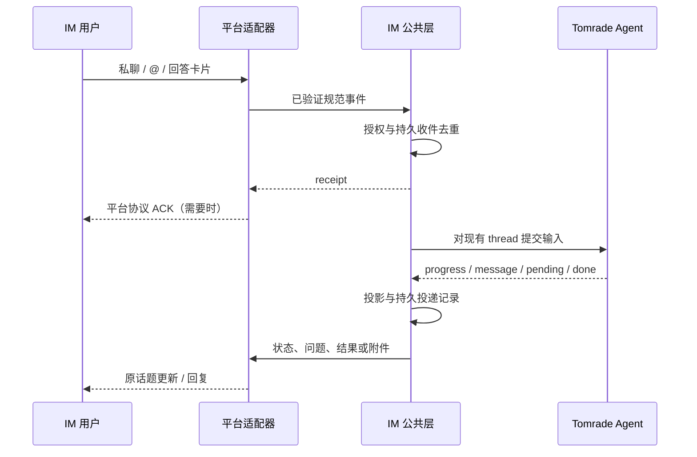

# IM 公共层插件设计

日期：2026-10-14（实现状态更新于 2026-10-15）。关联：TOM-94。状态：公共层与 SDK 契约已实现，见文末“实现状态”；尚无真实平台适配器。

用户已确认新的产品方向：IM 可以驱动完整 Agent 会话，包括闲聊、需求讨论、工单操作、执行和文档生成。TOM-94 已通过 Tomrade MCP 标为 Doing。现有 TOM-92、TOM-94 和 TOM-95～100 的正文仍是“只建 Backlog 工单”的旧范围，本设计不代表这些实现验收已经通过。

## 产品行为

同一个 Tomrade Agent thread 可以在桌面 Agent Panel 和 IM 中操作。IM 是新的交互入口；工单、delivery、run、产物、权限和历史仍由原来的服务持有。

- 私聊持续对话；群聊默认只有 @ 机器人或明确回复已绑定机器人的话题才激活。
- 讨论需求不自动建工单；是否建单、拆单、开工，由用户的指令和现有 Agent 工具/工作流决定。
- 执行期间回传简短进度；遇到提问和权限请求，回传可操作的交互；结束时回传结果、对象链接和受支持的文件。
- IM 创建的普通会话使用现有 `surface: assistant`，出现在桌面列表。接管既有会话需要显式绑定，不能默认把当前桌面会话公开到群里。
- `/new` 开新会话；`/stop` 中断当前执行；`/status` 看当前状态。平台原生 slash command 只是增强，同样的行为应能由机器人文本入口触发。
- 审批与普通聊天分开：“同意”只有明确回答当前问题时才有审批语义，不能默认放行所有操作。
- 完整会话不等于所有 engine 均可远程操控；terminal-only engine 的运行和审批需另行适配，第一期只支持 Agent 服务实际能驱动的 engine。

## 代码核验

| 已有能力 | 来源与限制 |
|---|---|
| thread、send、answer、steer、cancel | `packages/agent/src/service.ts`；已有 run 时普通 `send` 会拒绝，不能直接并发发送 |
| 结构化输出 | `packages/agent/src/types.ts` 的 `Block` 和 `AgentEvent`；delta/progress 为瞬态，完整消息持久化 |
| 提问与权限 | `PendingView`；workflow/ask 可持久化，运行中的 permission resolver 在内存，重启后旧审批不可恢复 |
| 工单、依赖、交付、Files | 现有工具及政策；IM 不维护第二套业务状态 |
| 本机凭据加密 | `packages/settings/src/index.ts` 与 `secrets.ts`；密钥链不可用时现实现会回退明文，不能宣称总是加密 |
| 第三方 Agent API | `packages/plugin-sdk/src/contract.ts` 的 `AgentApi` 只有 `playbook()`，SDK 事件也没有 `agent/event` |

结论：完整方案需要新的宿主契约。不能用当前第三方 SDK 实现一个完整 Agent Panel，再声称完全不用调整主程序。

## 三种接口候选

### A：最少方法

`im.register(adapter)`；adapter 只有 `connect(receive)` 和 `deliver(content)`，连接返回清理函数。用少数方法隐藏绑定、去重、执行与投递。

```ts
await ctx.im.register(slackAdapter(config));
```

优点是容易接入；代价是发送、修改、文件下载都藏进一个消息联合类型，适配器生命周期和账号配置容易混在一起。

### B：通用事件运输

`im.register(transport)`；transport 声明能力并实现 `open`、`deliver`、`download`。公共层接收规范化 message/action 事件，输出文字、状态、问题和文件；平台渲染成自己的消息或卡片。

```ts
await ctx.im.register({ id: "slack", capabilities, open, deliver, download });
```

它适合多平台以及不同安装方式，能明确降级行为。代价是要控制能力组合，避免为每个平台新增公共业务分支。

### C：声明式路由

用户声明 connection 和 route，公共层决定如何建会话、执行和输出。平台插件仅提供连接驱动。

```ts
await im.configureRoute({ connectionId, conversationId, projectId,
  mode: "assistant", groupActivation: "mention", allowedActors: [userId] });
```

它最接近用户的配置路径，但若把所有平台细节都放进公共 route schema，公共层会变成不断膨胀的平台配置中心。

**推荐 B 的适配器契约，结合 C 的用户配置。** A 的简洁原则用于限制注册接口；平台自己的配置和网络实现留在适配器内部。

## 插件边界

1. `@tomradex/im`：内置公共插件，提供 `ctx.im`。负责连接注册、授权、路由、会话映射、收件记录、输出投递、Agent 输出投影、交互令牌和状态设置。
2. `im-slack`、`im-feishu` 等：各自独立的平台插件。负责平台认证、Socket/Stream/轮询/HTTP、校验外部事件、及时平台 ACK、消息格式和文件传输。
3. Agent 服务：继续负责执行、工具权限、工作流、工单和交付语义。公共层只使用受支持的入口。
4. SDK：新增受限的 `im.register` facade、`ServiceName: im` 和 host 清理机制。第三方适配器不获得 raw Agent、数据库或任意项目操作权限。

第一期以可信内置适配器接入；SDK 注册契约可随公共层一起定义，但社区适配器启用前必须验证 facade、卸载和长连接行为。插件卸载停止连接和新入站，保留绑定及未投递记录；正在执行的 Agent run 不因渠道卸载自动取消。

## 推荐契约草案

以下都是拟新增类型，不是现有可调用 SDK。

```ts
interface ImAddress {
  tenantId: string;
  conversationId: string;
  topicId?: string;
}
interface ImCapabilities {
  edit: boolean;
  buttons: boolean;
  inboundFiles: boolean;
  outboundFiles: boolean;
  maxTextLength: number;
  maxFileBytes: number;
}
type ImInbound = {
  eventId: string;
  address: ImAddress;
  actor: { id: string; name?: string; isBot: boolean };
} & (
  | { kind: "message"; messageId: string; text: string;
      activation: "dm" | "mention" | "reply";
      attachments: ImAttachmentRef[]; permalink?: string }
  | { kind: "action"; token: string; value?: string | string[] }
);
interface ImAttachmentRef {
  id: string; name: string; mimeType?: string; size?: number;
}
interface ImContent {
  text: string;
  actions?: { label: string; token: string }[];
  files?: { id: string; name: string; mimeType: string }[];
  links?: { title: string; url: string }[];
}
interface ImDelivery {
  operationId: string;
  address: ImAddress;
  replaceMessageId?: string;
  content: ImContent;
}
interface ImAdapterSession {
  deliver(command: ImDelivery): Promise<{ messageId: string }>;
  download(ref: ImAttachmentRef): Promise<Uint8Array>;
  close(): Promise<void>;
}
interface ImAdapter {
  id: string;
  capabilities: ImCapabilities;
  open(connectionId: string, io: {
    receive(event: ImInbound): Promise<{ receiptId: string }>;
    status(state: "connecting" | "connected" | "offline" | "error",
      detail?: string): void;
    readOutboundFile(id: string): Promise<Uint8Array>;
  }): Promise<ImAdapterSession>;
}
interface ImApi {
  register(adapter: ImAdapter): Promise<() => void>;
}
```

每个 session 的 `connectionId` 由公共层注册时固定，入站 actor、tenant 必须来自已认证的平台事件。平台适配器不能在 payload 中任意指定其他连接。凭据由平台插件使用宿主 machine settings 保存和读取，不放进路由、消息、Agent 上下文或项目导出文件。

文件引用在 session 内解释。公共层只允许下载该已授权事件的附件；出站 `readOutboundFile` 只能读取公共层为该次投递准备的句柄，不能传本地任意路径。大文件应增加流式接口，第一期按现有媒体与平台中较小的限制处理。

## 绑定与权限

绑定键为 `adapterId + connectionId + tenantId + conversationId + topicId`，不能只用频道 ID。绑定内容包括 `projectId`、`threadId`、代际、允许的 actor 和输出策略。

- 私聊默认一个持续会话；群里每个任务话题各有会话。没有原生话题的平台用明确的回复关联；无法无歧义定位时让用户选择或新建，不能把多人所有消息混进一条私有会话。
- 用户在桌面确认目标项目、允许的用户/群和授权能力。群白名单只是允许触发入口，不自动赋予所有群成员项目读取、命令审批或交付验收权限。
- 一个群话题的历史对群成员可见，绑定前应明确输出受众；敏感私有桌面会话默认不允许绑定公开群。
- 外部 actor 绑定本机授权身份，并记录发送来源。单人本地模式由桌面 owner 授权；未来 Team 用户必须使用真实成员身份。
- Agent 工具写入继续记录 Agent 作者和 run。直接的人类审批需要宿主校验外部身份后执行，插件不能自己填写 `human` 来绕过策略。
- 第一期开启对话和现有执行权限审批。交付验收见下面“交付验收（TOM-172）”一节：只有绑定会话的发起人或已配对的身份能点。

## 收件、执行和投递



ACK 是平台协议确认，不是机器人已完成工作的回复。必须在平台要求的时限内完成；若无法及时持久收件，则按平台支持的重试机制拒绝/不确认，不能等 Agent 执行结束才 ACK。对于 SDK 自动提前 ACK 的渠道，应记录确认前崩溃的丢失窗口，不宣称零丢失。

公共层保留本机持久 inbox/outbox，用于去重和投递恢复；不建立云中继。桌面离线期间的消息是否重投由平台决定，不能保证所有平台补回历史。

建议本机表（均 `export: false`）：connections、routes、bindings、inbox、outbox、actions；connection 凭据仍在宿主 settings。inbox 去重键包括连接、tenant、eventId；messageId 另外索引以合并同条消息的重复事件。记录保留时间明确可配置，不能清理后仍承诺永久去重。编辑消息默认不再次执行，需用户明确重新提交。

按 Tomrade thread 串行处理输入；同一 thread 的桌面操作也算并发。engine 支持 steer 时允许显式追补指令，其他消息显示“已收到，待当前轮结束”；权限问题优先，不能被普通排队消息替代。`/stop` 只取消请求者有权控制的绑定 run。

**可靠性必需的宿主扩展**：Agent 输入入口增加持久 `requestId` 回执。输入标记与创建 run/输入记录须在同一宿主事务中提交；相同 requestId、相同输入返回原回执，冲突输入拒绝。仅靠 IM 插件去重，无法避免 `agent.send` 成功但 inbox 更新前崩溃导致重复执行。未补此能力前，对不确定收件不自动重放，显示“执行状态待确认”。steer 和 answer 同样需要回执。

outbox 采用固定 operationId、每目标有序投递、平台限流与退避。文字分段后各段有独立 operationId。发送成功但回执丢失时优先查平台或更新已有 messageId；平台无法核实时标为不确定，避免无限发送重复文件。跨平台不承诺 exactly-once。

## 输出与交互

| Agent 输出 | IM 投影 |
|---|---|
| delta/progress | 合并为简短状态；可编辑平台定期更新一条消息，节流间隔按平台限制配置 |
| text/message | 持久消息形成稳定输出；最终结果按平台字符限制分段 |
| trace | 默认仅显示工具名称和简短进度，不自动发送参数、终端日志或凭据 |
| pending/question | 选项按钮和明确的自由文本回复，绑定当前 questionId |
| card | 已支持 schema 转为语义卡片；未知 schema 用摘要及桌面入口 |
| changes | 工单号、变更摘要和具体对象链接 |
| media/artifact | 支持格式的附件；交付产物固定 fileId + versionId |
| error/retry/park | 显示失败、重试或限流状态；投递失败不改 Agent 的执行结果 |

动作使用随机 opaque token；宿主持久保存对应连接、绑定代际、actor/audience、thread、run、questionId、允许值、有效期与一次性消费状态。收到动作先核对来源和当前 pending，再调用现有 answer 路径。桌面已回答、重复点击、已取消 run、重新绑定或过期 token 都返回“已处理或已失效”，不能影响另一轮执行。

不支持按钮时使用 `回复问题 Q7：2` 这样的明确格式并校验 actor 与 question，不能把普通“好”当作权限批准。重启使旧内存 permission 请求过期；恢复仅重绘仍然有效的持久问题。IM 断线不改变等待语义，也不自动批准。

附件先检查大小、实际 MIME 和允许格式，再进入 Agent media 或 Files。现有 Agent attachment 不能表示的文档需通过 Files 专用导入入口；第一期未实现该入口的格式明确提示，不假装已交给模型。用户明确保存的文档进 Files；临时图片无需自动成为 delivery artifact。

## 接入与审核：产品安装方式

第一期采用用户自带应用凭据、本机直连。公共层身份用 connectionId，不绑定为“唯一官方 bot”，以后可并存 BYO 与托管安装。

| 渠道 | 内部 / 自建接入 | 官方公开分发 |
|---|---|---|
| Slack | 创建 app，启用 Socket Mode，生成 App-Level Token（connections:write）并安装获取 Bot Token；团队可能要求管理员批准 | 商业分发应提交 Marketplace；Socket Mode 当前不能上架，公开应用需 HTTP 事件/交互入口 |
| 飞书/Lark | 创建自建应用，开启机器人、申请权限、订阅消息、发布并配置可用范围；企业审批与个人免审不同 | 商店应用需要平台发布审核，飞书与 Lark 的资格、审核和安装分别验证 |

不只是拿 API key：凭据、权限、事件订阅和安装发布都要完成。设置向导提供 Slack manifest 和飞书配置步骤，完成后验证 bot/tenant 身份，随后绑定项目与允许用户。

凭据使用 machine scope，agent access 为 none，日志脱敏。启用前检测宿主实际 secretStorage；缺少加密能力时明确显示存储状态并要求用户作出显式选择，不能静默称作加密存储。

## 实施切片与验收

本次只交付设计。后续实现按可验证链路推进：

1. 内置公共层 + 假适配器：规范消息、连接生命周期、授权、外部话题绑定、新建 assistant thread、文字收发与桌面共用历史。
2. 宿主幂等输入 + 本机 inbox/outbox：重复、重启、并发、执行成功/记录失败窗口、投递不确定状态。
3. pending/answer/cancel：真实权限请求，重复和过期按钮，两端同时答复，运行中消息策略。
4. Slack Socket Mode 与飞书自建长连接：用真实测试账号验证认证、消息、线程回复、交互和重连；主机关闭时不承诺可用。
5. 媒体与 Files：格式限制、单个/总大小限制、版本固定、下载授权、发送失败恢复。
6. SDK adapter facade 与卸载：命名空间、权限声明、长连接和资源清理验证后再允许社区扩展。

核心验收：普通对话不自动建工单；明确指令可通过现有工具拆单和开工；桌面与 IM 显示同一 thread 历史；去重不会启动第二次执行；未授权 actor 不读项目或批准操作；桌面答复后旧卡片失效；结果返回原话题；生成文档仍由 Files 管理；重启不把内存 permission 假装恢复。

TOM-92 与平台子工单需要根据新目标重新确认范围。按 CONTEXT.md，目标发生实质变化的旧工单应取消并创建替代工单，迁移依赖前询问用户；本次只同步 TOM-94 状态和设计成果，不改这些工单或依赖，也不把 TOM-94 标为 Done。

## 资料

- [Slack 应用分发](https://docs.slack.dev/app-management/distribution/)
- [Slack Socket Mode 限制与配置](https://docs.slack.dev/apis/events-api/using-socket-mode/)
- [Slack HTTP 与 Socket Mode 对比](https://docs.slack.dev/apis/events-api/comparing-http-socket-mode/)
- [飞书自建应用发版审核指南](https://www.feishu.cn/hc/zh-CN/articles/374230668270-%E8%87%AA%E5%BB%BA%E5%BA%94%E7%94%A8%E5%8F%91%E7%89%88%E5%AE%A1%E6%A0%B8%E6%8C%87%E5%8D%97)
- [飞书开放平台更新：长连接与个人自建应用免审](https://open.feishu.cn/changelog?abilityType=Tool&lang=zh-CN)
- [Cindy IM 协议](https://github.com/makecindy/cindy-protocol/blob/main/docs/slack-hook-protocol.md)

以上规则依据调研时的公开文档；每个平台适配器实现时再核验对应地区、应用类型和当前能力。

## 实现状态（2026-10-15）

已实现（`packages/im`、`packages/plugin-sdk/src/im.ts`）：

- 内置 `ctx.im` 服务，SDK 契约 `0.2.2`：`im.register(adapter)`、`ServiceName: im`、manifest `contributes.imAdapters`。扩展 facade 限定命名空间，卸载时关闭连接、拒绝后续入站。
- 设置 `im`（machine scope，agent 不可读）：connections 与 routes；route 指定项目、可选 board/engine、允许的 actor、是否接受私聊/群聊。未授权、机器人和未开启的激活方式直接忽略，只保留最近 20 条不含正文的诊断记录。
- 绑定键：连接 + 地址 + route 的目标（项目、board、engine、适配器）。修改允许名单或激活方式不会新开会话；改目标项目/engine 会进入新绑定。
- 收件去重：`连接 + tenant + eventId` 与 `连接 + 会话 + messageId` 双键；同一 eventId 内容不同则拒绝。Agent `send` 支持持久 `requestId` 回执，与 run 同事务写入，崩溃重放返回原 run。
- 输入按 thread 串行；`/answer`、按钮动作、`/stop`、`/status` 优先；`/new` 新开 assistant thread。问题动作令牌绑定连接、thread、run、questionId、actor 与有效期；桌面答复、过期、重新绑定后旧卡片改为“已处理或失效”。普通文字从不当作审批。
- 输出：持久消息、错误、变更、媒体、卡片标题、问题；可编辑平台节流更新进度消息，不可编辑平台只收稳定输出（不发“本轮执行结束”）。按 UTF-16 代理对安全分段。outbox 每目标有序，已知未发送可重试（同 operationId），结果未知标为 `uncertain` 不自动重发，也不阻塞该会话后续回复；`im.retry` / `im.discard` IPC 由人处理。
- 投影由 Agent 事件驱动，另有 `sweepMs`（默认 5 秒）兜底扫描；完成的 inbox/outbox/动作记录保留 `retentionMs`（默认 30 天）后清理，更早事件的重放由 Agent 输入回执阻止再次执行。
- 状态栏显示每个连接的状态与待确认数，中英文随桌面语言；IM 中的拒绝提示同样本地化。

验证：`pnpm typecheck`、`pnpm test` 全部通过；`packages/im/tests` 覆盖去重、授权、审批、多选/自由文本、`/stop` `/status` `/new`、限流顺序、不确定投递、媒体句柄、下载中撤销授权、保留期清理；`websocket.test.ts` 用本机 WebSocket 服务验证 SDK 扩展的长连接、断线重连与卸载关闭。`packages/im/tests/fixtures/fake-adapter` 通过 `tomrade-plugin check`（ok · risk low）与 `tomrade-plugin test`，并纳入 `packages/plugin-cli` 测试。

**长连接结论**：已安装扩展在主进程内通过 SDK facade 运行，可以保持 WebSocket 等长连接；宿主负责 `signal`、断线退避重连和卸载关闭。网络权限目前是声明 + `plugin check` 静态分析告警，并非运行时拦截；真实适配器需在 manifest 声明平台域名。

尚未实现（需另开工单或后续切片）：

- Slack、飞书真实适配器与真实账号验证（连接向导见 TOM-121 一节）。
- 输出链接、Files 版本导出和任意文档导入。目前只支持 Agent media 支持的附件。
- 跨平台不承诺 exactly-once（uncertain/failed 投递的桌面处理见 TOM-121 一节）。
- TOM-92 与平台子工单的范围仍是旧的“只建工单”，需按新目标重新确认。

## 适配器契约 v2（TOM-117，SDK 0.2.5）

增量契约：0.2.2 适配器不改代码继续可用（没声明的能力按 0.2.2 行为处理）。

- **能力声明**（都可选）：`threads`、`reactions`、`typing`、`stream`（`native` / `edit` / `none`）、`select`、`multiSelect`、`textInput`、`cards`、`cardUpdate`（默认同 `edit`）、`nativeCommands`、`ephemeral`、`markdown` 方言（`plain`、`markdown`、`slack`、`telegram-html`、`discord`、`lark`、`dingtalk`、`wecom`，默认 `markdown` 原样透传）、`rateLimit`（每会话窗口内条数）。注册时用 `ImCapabilitiesSchema` 校验。
- **内容**：公共层统一写 Markdown，`ImContent` 增加 `elements`（section/fields、links、单选/多选 select、自由文本 input）和按钮 `style`。投递前 `prepare()` 按能力降级：不支持的元素折成文字（选项和 `/answer` 用法写明，不丢信息），再转成平台方言、按长度分段（`splitImText`：按行切，代码块能放下就整块保留，过长则闭合后带语言重开，不切代理对；长度按转换后计）。控件和文件放在最后一段。
- **回复锚点**：群聊激活（mention/reply）时绑定记下触发消息；有话题的地址回到原话题，平台支持 `threads` 时 `threadId` = 触发消息，否则 `replyTo` 引用回复。群里的拒绝提示在支持 `ephemeral` 的平台只给发送人看（`visibleTo`）。
- **新 io**（都是 best effort，失败不重试不报错）：`indicate`（运行中每 4 秒刷新 typing，结束 idle）、`react`（接受 received，结束 done / failed）、`commands`（每次连上后注册原生指令；原生指令以纯文本命令进入，纯文本始终可用）。
- **流式**：`native` 用 `stream.start / append / stop`，`edit` 退化为按 `progressMs` 节流编辑同一条消息，`none` 只发终稿。流式行是 outbox 里的一行（`stream = 1`），Agent 文本消息落库时标记 `stream_of`，投影时用终稿替换并定稿；运行结束仍未定稿的保留已显示内容。append 失败只算可重试，终稿 stop 兜底。
- **交互回调时限**：适配器先在平台时限内确认，`receive` 持久收件后立即返回，结果再更新卡片（`cardUpdate`）。
- **限流**：`rateLimit` 按会话计数，超限的会话暂缓、其他会话照常，同会话顺序不变。
- **plugin check**：报告每个适配器的契约版本和声明的 v2 能力（`imAdapters`）；能力不合法为阻断问题；声明了 v2 能力但 `engines.sdk` 仍允许 0.2.5 以下时只给提示（旧版 Tomrade 会忽略这些能力）。

流式回答的完整渲染（工具摘要、卡片、变更链接）见 TOM-120；收件回执三态、插话见 TOM-118。

## IM 设置面板（TOM-121）

设置里的 IM 面板替代通用 JSON 编辑器，状态栏的 IM 项点击直接打开它（`opens: "settings:im"`）。

- **连接向导**：适配器可声明 `setup`（SDK 0.2.5）：凭据字段（`secret` 画成密码框）、平台后台步骤、权限清单、可复制的 manifest、文档链接。面板按它生成表单；必填凭据没填完连接保持“未配置”、不会打开。保存后连接打开，适配器在 session 上给出 `identity`，面板显示“已登录为 …”作为验证结果；凭据变化会重开连接。
- **凭据加密**：凭据存在 `im.connections[].credentials`，`credentials` 与 `env`、`headers` 一样整张表按 TOM-61 的规则用系统钥匙串加密写入 settings.json，`open` 时以 `io.credentials` 解密后交给适配器；不进路由、事件、Agent 上下文和日志。钥匙串不可用时面板明示“明文保存”，改动凭据必须勾选确认才能保存。
- **配对**：桌面为某个连接生成 6 位一次性码（10 分钟有效，新码替换旧码，连错 5 次作废）。用户私聊机器人发 `/pair 123456`，公共层先回复“请在桌面确认”，桌面确认后才写入：身份进 `im.identities`，该私聊会话建 route（选定项目、允许此人）。可在面板撤销：身份移除，并从该连接所有 route 的允许名单去掉，空 route 随之删除。
- **route 编辑**：项目、助手 engine 及其选项（engine 的 picks，如模型/effort，写入 `options`，新线程带上）、私聊/群聊开关、群聊激活方式（`mention` 仅 @；`reply` @ 或回复，默认；`all` 所有消息，适配器以 `activation: "ambient"` 送来）、输出（`progress` 进度和逐步生成；`final` 只发回答和问题）。`options` 仅在设置时进入绑定哈希，旧 route 不会因此换新会话。
- **被忽略的消息**：最近 20 条，记连接、会话、发送人、是否群聊和原因（不在名单 / 会话未接入 / 激活方式未开 / 机器人），不含正文；群里与机器人无关的 ambient 消息不记录。一键“允许此人”把发送人加入该会话 route；“允许此群”开启群聊，并放行已配对的人和发送人（群白名单只开入口，不放行全体成员）。会话还没有 route 时用面板选定的项目新建。
- **投递异常**：列出 uncertain / failed 投递（连接、会话、正文前 120 字、错误），可重试（`im.retry`）或丢弃（`im.discard`）；面板提示 uncertain 可能已送达、重试可能重复。
- 面板数据走 `im.connections`、`im.adapters`、`im.ignored`、`im.deliveries`、`im.pairings` 等 IPC，主进程变化时广播 `im.changed` 刷新。

## 运行中的消息（TOM-118）

和助手输入框（TOM-102 排队、TOM-103 插话、TOM-106 /help）保持一致：

- **回执三态**：接受时表情回应 received 并显示 typing；排在当前这一轮或待答问题之后的普通消息立即收到“已排队（第 N 位）”，可编辑平台随位置原地更新、开始执行时改成“正在执行”，不可编辑平台只发一次；拒绝沿用“无法处理消息：原因”。
- **插话**：`/steer 内容`，或在消息里回复（`replyTo`，SDK 0.2.5）当前这一轮的进度或流式消息，经 `agent.steer` 送进正在运行的这一轮，`steerId` 为 `im:<收件 id>`。engine 不支持插话或这一轮没接住时，明确提示并转为排队（`input_json` 记下正文，之后按普通消息执行）；没有运行中的轮次时 `/steer` 就是普通消息。
- **排队管理**：`/queue` 列出等待中的消息（前 60 字）；`/unqueue N` 撤回第 N 条，只有发送人可以撤回。适配器上报 `retract`（撤回）时，尚未执行的那条同步取消；上报 `edit`（编辑）时不重跑，提示需要重新发送。两者都只认原发送人，不入收件队列。
- **/help**：列出项目、当前助手和全部指令，与原生指令注册用同一份列表（`/stop /status /new /answer /steer /queue /unqueue /help`），中英文随桌面语言；并说明当前助手是否支持插话。
- **/status**：当前这一轮在做什么（engine 上报的 activity）、等待中的消息数和待回答的问题。

`/stop` 仍会清空等待中的消息，与桌面“中止后排队消息保留”不同，未在本工单改动。

## 流式回复与富内容（TOM-120）

- **流式**：沿用契约 v2 的 native / edit / none；节流默认改为 1.5 秒（`progressMs`），终稿与桌面同一条 Agent 文本消息。进度消息被节流时不再丢掉最后状态，间隔到了补发最新的一帧。
- **工具过程**：默认不单独发消息，只在进度消息里加一行（最近 6 个工具名 + ✓/✗），结束定稿时保留；不发参数、输出或凭据。route 输出新增“详细”（`verbose`），每次工具调用另发一行。模型重试时进度消息显示“重试中（第 N / M 次）”。
- **卡片**（`packages/im/src/rich.ts`）：`start` 渲染为工单卡；`backlog.proposal` 渲染为计划（史诗与功能列表），确认仍走问题按钮；`checklist` 按行显示状态；未知 schema 给标题和“在 Tomrade 查看”会话链接。
- **变更**：每个工单一张卡（操作 · key 标题，状态、优先级，“在 Tomrade 打开”），最多 8 张，其余计数；不支持卡片的平台折成文字和链接。
- **产物**：本轮 `write_file` 保存的文件按工具返回的 fileId + versionId 作为附件发回（句柄 `files:<fileId>:<versionId>`，`readOutboundFile` 读取那一版），正文带文件深链；平台不支持附件、超过大小或 Files 读取被截断时只留链接。`write_file` 结果把 id 放在前面，保证运行摘要截断时 id 还在。
- **深链**：`tomrade://item/<项目>/<key>`、`thread/<项目>/<会话>`、`file/<项目>/<fileId>`。桌面注册 `tomrade:` 协议（`electron-builder.yml` 的 `protocols`、`src/deep-link.ts`），macOS `open-url`、其他平台第二实例参数都转给 `deep-links` 插件，解析后主窗口前置并广播 `app.open`，界面打开工单、会话或文件；对象不存在时只把窗口带到前面。

未做：入站文档按用户要求存入 Files（需要新的导入入口），目前附件仍按 Agent media 能力处理，不支持的格式明确提示。

## 会话切换与选项指令（TOM-119）

- **`/sessions`**：本项目最近 20 个助手会话（标题、助手、最后活动），标出当前会话和正在运行的；平台有选择控件时附单选，否则用 `/switch N`。群里的列表只给发起人看（平台支持 ephemeral 时）。只有 route 允许的成员能用。
- **`/switch N`**：IM 会话改绑到所选会话（序号按发起人最近一次 `/sessions` 的列表）。只发该会话此后的消息，历史留在桌面。正在运行的会话、当前会话还在运行或等待回答时不允许；只列 assistant 会话，code 会话不在其中。群聊里先提示“群里所有人都将能看到该会话的历史”，由发起人按按钮确认（无按钮平台回复 `/switch N confirm`），其他成员点按钮无效。
- **`/archive`**：归档当前会话，按 route 设置开新会话。
- **`/engine`、`/model`、`/effort`、`/mode`**：不带参数时列出当前值和可选项（engine 列表、engine 的 picks、permissionModes，与桌面面板同一份数据），带参数时写入 thread（`setEngine` / `setOptions` / `setPermissionMode`），桌面面板显示相同选项。选项和模式运行中修改从下一轮生效；切换助手只能在两轮之间。`/model default` 恢复默认。
- 选择控件的令牌记在动作表里（`question_id = cmd:<种类>`），只认提供给的那个人，用一次即失效，过期后清理；不参与问题卡片的收口。
- **route** 增加默认权限模式（`permissionMode`），连同默认助手和选项用于 IM 新开的会话；设置面板里可选。
- 顺带修复：`/new` 改绑后的“已开始新会话”原先挂在旧会话上，发送时被当作过期丢弃，现在走新会话。

未做：route 绑定多个项目和 `/project` 切换（默认只绑一个项目，工单验收不含）。

## 受众与回流、需要你处理时提醒到 IM（TOM-122）

- **回流规则**（投影、进度、流式、问题卡片都按轮次判断）：IM 发起的轮次总是回到发起它的会话（`plugin_im_runs` 记录，旧数据看收件的 run_id）。私聊里桌面发起的轮次也同步过去，route 可关（`desktopTurns`）；群聊只回传 IM 发起的轮次，桌面要回流必须在助手面板上点“下一轮发到群里”，只对那一轮有效（`share_next`，`im.shareNext`）。没有轮次的系统提示只进私聊。
- 绑定记下是私聊还是群聊（`grp`，旧绑定按最近一条消息推断）。私有桌面会话接管到群仍按 TOM-119 需要发起人确认。
- **提醒到 IM**：桌面 attention 模块决定要发通知（没有窗口在前台、该类开关打开）时，按通知设置里的“不在电脑前时，还提醒到”（`notifications.away`：`im` / `none`，单选）交给 `im.remind`。只处理权限请求、提问和执行失败：发到发起人的私聊（会话没绑定 IM 时发给已配对的人），带“在 Tomrade 打开”链接；问题和权限带按钮（多选用选择器、自由文本用输入框，无控件时 `/answer`），点按钮直接回答原会话，答过后再点提示已处理。该私聊已经显示这一轮时不重复提醒。TOM-93 的手机推送作为 `away` 的另一个取值加入，同一事件只去一处。
- **上下线提示**（`im.announcePresence`，默认关）：连接上线时在已绑定私聊说一次“已上线”；适配器卸载或应用退出前说“即将下线，离线期间的消息可能收不到，上线后请重新发送”。各平台离线补发能力不同，统一按“可能收不到”提示。

## 工单话题（TOM-436，SDK 0.2.19）

群里的主会话不被工单动态刷屏：平台能开话题（声明 `topics`、实现 `session.topics.open / update`）且 route 的 `ticketTopics` 没关（默认开）时，正在推进的工单各开一个话题，这张工单的动态发到话题里。

- **何时开**：工单变成 Doing 或 Verifying、watch 的工单代码有新动态、交付等待验收、从这个群 `/start` 开工。开之前的动态不排队，话题开好后第一张卡片是工单当前的样子，代码动态和交付卡片随后补发（watch 的 `seen` 在话题开好前不更新）。开不了（适配器报错、不可重试）时状态记为 `failed`，在群里说一句工单现在的状态，之后的动态照旧发群里。
- **话题会话**：话题是一个绑定（地址带 `topicId`，和 `receive` 算出的绑定 id 一致），行在 `plugin_im_topics`。没人说话前它挂着群的会话但什么都不显示，第一条消息才给它开一个以工单命名的会话（`own = 1`），所以不会给每张工单都留一个空会话；Agent 收到的上下文里有话题是关于哪张工单。从群里 `/start` 开工时话题直接绑到这次的工单会话，进度和问题在话题里，群里不再给“在这里跟进”。会话被归档后话题退回挂着群的会话，不发提示。
- **路由**：群里这张工单的状态、PR 与合并、git 的状态提议、交付卡片发到话题（按钮由话题的绑定签发，在话题里点）；话题绑定自己不收项目广播和例行事务，只经过群收到自己工单的动态。没有话题的工单仍在群里一行。
- **标题与关闭**：标题是“KEY · 状态 · 标题”，跟着状态改；Done / Cancelled 时等话题里排队的消息发完再关闭（Discord 归档），回到别的状态再打开。改标题和关闭是装饰性的，发不出去就放弃。
- **扩展宿主**：`packages/extensions` 包装适配器会话时把 `topics` 一并转过去。

## Discord 适配器（TOM-100）

官方插件 `tomrade/discord`（tomrade-plugins 的 `packages/discord`，命名空间 `discord`；TOM-300 之前随应用内置，现在由官方目录的 starters 每台机器装一次，配置连接前什么都不做）。网络权限只声明 `discord.com`、`discord.gg`、`discordapp.com`、`discordapp.net`。只需要 Bot Token，不开特权 Intent（GUILDS、GUILD_MESSAGES、DIRECT_MESSAGES）：私信和 @ 本身带正文；没有 Message Content 时频道里的其他消息正文为空，不送公共层。

- **Gateway**：心跳带抖动，漏一次 ack 视为僵尸连接；断线后用 `resume_gateway_url` + 会话号 resume，Discord 补发漏掉的事件，公共层按事件 id 去重；op 7/9、4007/4009 按规定重连或重新 identify；4004（令牌错误）和 Intent 类关闭码直接报“连接失败”，交给公共层退避重开。
- **入站**：私信 → `dm`（tenant `@me`）；@ 机器人 → `mention`；回复机器人消息 → `reply`。帖子（thread）是父频道的话题（`topicId`），所以父频道的 route 覆盖它。附件按 CDN 地址下载。删除自己发的消息 → `retract`，编辑 → `edit`。
- **交互**：按钮、单选/多选 string select、自由文本用按钮弹出 modal；组件先回 `DEFERRED_UPDATE_MESSAGE`（type 6），`/tomrade <子命令>` 先回 `DEFERRED_CHANNEL_MESSAGE`（type 5），都在 3 秒内，之后再交给公共层。延迟回复被改写成“› /status”这条可见消息，回复引用它。
- **出站**：Discord Markdown，2000 字分段；小节为 embed，按钮和选择器为组件（最多 5 行），编辑时总带上 components 以便收口后摘掉按钮；`tomrade://` 链接 Discord 不允许做链接按钮，作为文字显示。消息带强制 nonce，丢回应后重试也不会重复发；429 按 `retry_after` 退避；每频道每 5 秒 5 条。👀 / ✅ / ❌ 表情回执，typing。文件上限 10 MB（multipart）。
- `/tomrade` 指令：每个 IM 指令一个子命令（带 `args` 文本参数），每次连上后整体覆盖注册。
- 测试：`src/fake.ts` 是内存中的 Discord（Gateway + REST）；`tests/` 对着假 Discord 直接驱动适配器；`src/test.ts` 是 `tomrade-plugin test` 场景，接真实 IM 公共层和 Agent 跑完整对话。真实账号逐项验收需要你的 Discord 测试服务器。

## 代码进展（TOM-171）

IM 不依赖 code link 包，只在运行时读 `ctx.codeLink`（没有加载就不显示代码信息，读取失败也只是不显示）。

- **工单卡**：在状态、优先级之后加上当前交付的主链接（有开着的 PR 优先），显示分支、PR（`#12 · 进行中/已合并/已关闭`）或合并提交，以及编码会话状态（合并被阻塞时显示“等你合并”）。PR 的 http 链接排在“在 Tomrade 打开”之前，Discord 上会成为链接按钮。
- **读取工具** `get_code_links(key)`（只读，桌面和 IM 的 agent 都能用）：返回当前交付的分支和 PR、ahead/behind、合并状态、编码会话（状态、在做什么、是否阻塞），以及 git 提出的状态变更。数据来自 `CodeLink.summary(projectId, itemId)`。
- **关注与推送**：会话里出现过的工单（变更卡片、开工卡）记进 `plugin_im_watch`，同时记下当时的代码状态；再次出现会刷新时间，超过 `retentionMs` 就清理。`codeLink/changed` 时逐个比较，只推新的事件：PR 已开、已合并、PR 关闭未合并、合并等你处理、新的 flag。消息不挂在某一轮下面，所以群里只推这个群看到过的工单（受众同 TOM-122）。
- **状态提议**：新的 propose 提议单独发一张卡，带“接受 / 这次不用”按钮，只有绑定会话的发起人能点。点了就调用 `codeLink.resolve`，和桌面上“接受提议”是同一次人工写入，卡片随后改成结果。在桌面上处理过的提议，IM 卡片会摘掉按钮，写明“已在 Tomrade 处理”。

## 交付验收（TOM-172）

IM 只在运行时读 `ctx.items`，通过 `oplog/appended` 得知工单变化（在写入提交之后处理）。

- **交付卡**：最新一次提交在 Verifying 且还没有结论时，向两类会话推送交付卡：看过这张工单的会话（`plugin_im_watch`，没有加载 code link 也会记录），以及提交交付的那一轮所在、且能看到这一轮的会话。卡片含报告（超过 1500 字截断）、工单卡（含代码进展）和产物链接，带“接受 / 要求修改”按钮。受众规则同 TOM-122。
- **验收**：点“接受”或填写修改意见后，调用 `items.reviewDelivery`，这和 `review_delivery` 工具写入的是同一个服务。结论记为人工验收；评论里记下原话，以及验收人（配对身份的名字和 IM 账号）。“要求修改”会发一条带文本输入的消息；平台没有输入控件时，改为提示 `/answer <token> <修改意见>`。
- **谁能点**：绑定会话的发起人，或者在桌面配对过、并且在该路由允许名单里的身份。
- **失效**：交付在别处验收、被新的提交取代，或者不再处于 Verifying 时，IM 卡片摘掉按钮，并写明原因（已验收通过、已退回修改、已有更新的交付、已不再等待验收）。在 IM 点已失效的按钮，也会先更新卡片再提示。

## 从 IM 开工（TOM-173）

开工只在本机以 headless 方式运行（`codeLink.start(..., { mode: "run" })`），IM 不打开终端。

- **入口**：
  - `offer_start` 的开工卡上有"开始 / 继续"和"调整配置"两个按钮。工单已有会话或已关联分支时，显示为"继续"。
  - 也可以直接用 `/start KEY`。私聊里写了参数（`/start KEY engine=… model=… effort=… mode=… playbook=…`）就直接开工；不写参数时，先发一张配置卡。
- **配置**：
  - 默认值取 `startDefaults()`，即本机上次开工的选择，前提是该助手还能在本机 headless 运行。换了助手，就从这个助手自己的默认值开始。
  - 配置卡逐项列出：助手、助手的每个可选项（模型、推理强度等）、权限模式（仅编码工单），General 工单还有交付方式。
  - 平台支持选择控件时，每项一个下拉，改动后卡片原地更新，旧卡片上的选项随之失效。没有选择控件时，卡片提示用 `/start KEY k=v` 修改。
- **Gate**：
  - 工单被未完成的工单阻塞时，给出"仍然开始"按钮（`allowBlocked`），并保留已选的配置。
  - 其他 gate 只说明原因，附"在 Tomrade 打开"链接，到桌面处理。
  - 开工结果里的 `waitingOn` 和 `warnings` 会写进"已开工"消息。
- **跟随**：
  - 开工成功后，这个 IM 会话改绑到工单线程，起点是这次开工的那一轮。那一轮记入 `plugin_im_runs`，所以群里也能看到。
  - 进度、问题和权限请求都回到这里，在 IM 里回答或插话就是对编码会话说话。
  - `/sessions` 可以回到之前的会话。
- **安全**：
  - 群里只有绑定会话的发起人能开工。按钮只发给发起人，别人用 `/start` 会被拒绝。
  - 在群里先发配置卡，并写明群里所有人都将看到进度和问题，发起人点"开始"即确认。
  - 开工的 brief 带上 IM 来源（连接、租户、会话、发起人），记在 Agent 的输入记录里（`StartOptions.source`）。
